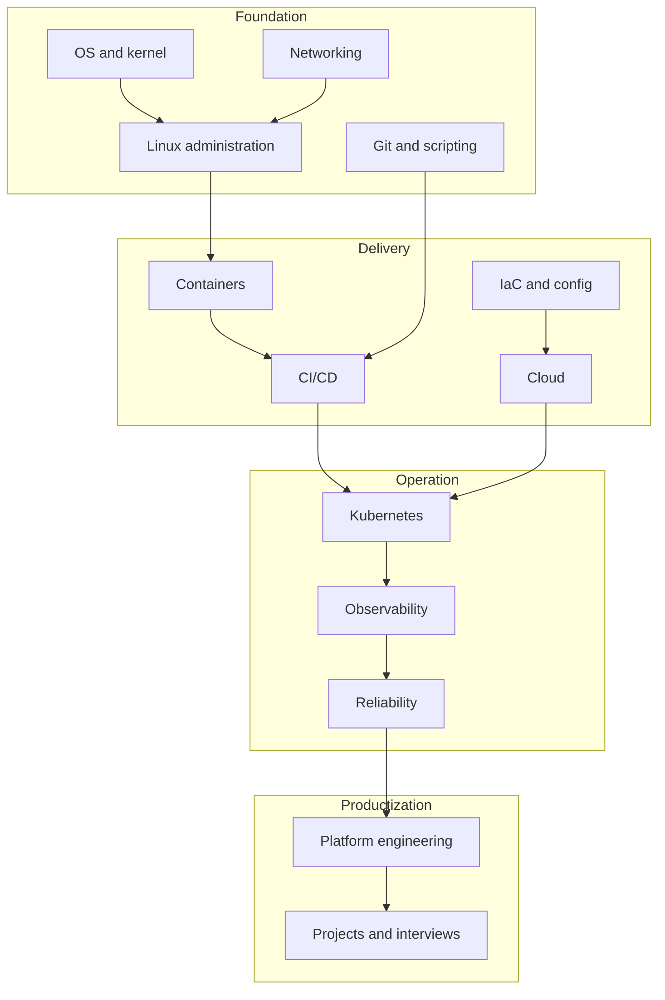

# Knowledge Map: Learn in Dependency Order

[← Home](../README.md)

## The directional path

## Six stages

### Stage 1 — Follow one request

Learn DNS resolution, routing, TCP or QUIC, TLS, HTTP, reverse proxies, processes, files, and sockets. Your proof of learning is explaining what happens after entering `https://example.com` in a browser.

### Stage 2 — Operate one Linux service

Install a small service, create a non-root service account, manage it with systemd, inspect logs, bind it to a port, restrict the firewall, measure CPU/memory/disk, and recover it after failure.

### Stage 3 — Package and deliver it

Put source in Git, write tests, build an image, scan it, publish an immutable tag/digest, deploy with Compose, and build a CI pipeline that can safely fail.

### Stage 4 — Reproduce infrastructure

Use OpenTofu/Terraform for resources and Ansible or image building for machine configuration. Store state remotely, lock it, review plans, use short-lived identity, and test before applying.

### Stage 5 — Orchestrate and observe it

Deploy to Kubernetes. Understand the API request lifecycle, controllers, scheduling, CNI, Services, Gateway/Ingress, storage, RBAC, probes, resources, telemetry, and incident triage.

### Stage 6 — Specialize

Choose one role track:

- DevOps: delivery automation across code, infrastructure, and operations.
- SRE: reliability, SLOs, incidents, capacity, and toil reduction.
- Platform Engineer: reusable self-service capabilities and developer experience.
- Linux Administrator: host lifecycle, identity, storage, networking, security, and recovery.

## Dependency matrix

| Topic | Requires | Unlocks |
|---|---|---|
| Docker | Linux processes, filesystems, networking | CI images, Compose, Kubernetes runtimes |
| Kubernetes | Containers, DNS, TCP/IP, YAML | scalable orchestration and platform work |
| OpenTofu/Terraform | Cloud APIs, Git, state thinking | reproducible environments |
| Ansible | Linux, SSH, YAML | repeatable host configuration |
| CI/CD | Git, tests, artifacts, credentials | safe automated delivery |
| Observability | applications, networks, distributed requests | evidence-based troubleshooting |
| SRE | observability, automation, distributed systems | measurable reliability |
| Platform engineering | Kubernetes/IaC/CI plus product thinking | self-service golden paths |

## The depth rule

Study each subject at three depths:

| Depth | You can… | Example |
|---|---|---|
| Explain | define the problem and mental model | “A Service gives stable discovery over changing Pods.” |
| Operate | configure, inspect, and recover it | trace DNS → EndpointSlice → Pod and fix the selector |
| Design | choose it, reject it, and explain trade-offs | decide Gateway API vs cloud LB vs direct Service |

Do not jump to “design” before you can operate the component.
