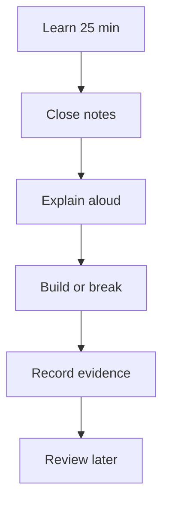

# Study and Retention System

[← Home](../README.md)

## Use active recall, not rereading

Rereading produces familiarity. Interviews and incidents require retrieval. Use this loop:



### The 25–10–15 session

- 25 minutes: read one concept and draw its flow.
- 10 minutes: close the note and explain it in your own words.
- 15 minutes: run one command, inspect one real output, or answer one scenario.

### Spaced review

Review the same concept after 1, 3, 7, 14, and 30 days. A review should be a question or lab, not another full read.

## The Feynman card

For every chapter, create one small card:

```text
Problem:
Mental model:
Request/data flow:
State owned:
Failure signals:
Three commands:
Security boundary:
Trade-off:
```

## The troubleshooting journal

Your existing notes contain valuable failures, but many read like terminal history. Convert each incident into durable knowledge:

| Field | What to write |
|---|---|
| Symptom | exact user-visible or monitoring failure |
| Scope | one Pod, node, service, zone, or whole system? |
| Recent change | deploy, config, certificate, quota, network, data |
| Evidence | event, log line, metric, trace, packet, process state |
| Hypotheses | ranked; state what would falsify each |
| Root cause | mechanism, not merely the component name |
| Fix | smallest safe corrective action |
| Verification | user journey plus technical checks |
| Prevention | test, alert, guardrail, documentation, automation |

> [!IMPORTANT]
> “Postgres permission issue” is not a root cause. “The NFS directory owner did not match the numeric UID used by the Postgres container, so the process could not create database files” is a root cause.

## Weekly learning rhythm

| Day | Activity |
|---|---|
| Monday | Learn and diagram one concept |
| Tuesday | Build a minimal example |
| Wednesday | Break it deliberately and recover it |
| Thursday | Explain five interview questions aloud |
| Friday | Write one incident card or architecture decision record |
| Saturday | Integrate the topic into a project |
| Sunday | 30-minute spaced review; no new tools |

## What not to memorize

- Entire command lists. Memorize purpose and discovery: `--help`, `man`, logs, status, describe, inspect.
- Tool versions. Know support policy and how to verify the current version.
- Cloud service catalogues. Learn compute, storage, network, identity, database, observability, and cost patterns.
- YAML indentation by sight. Learn the API schema and validate it.
- Generic definitions. Tie every definition to a request flow or failure.

## Proof of mastery

A topic is “green” only when you can:

- explain it in under two minutes;
- draw its components and trust boundaries;
- build a minimal working example;
- diagnose three realistic failures;
- compare it with one alternative;
- state what you would monitor and back up.
