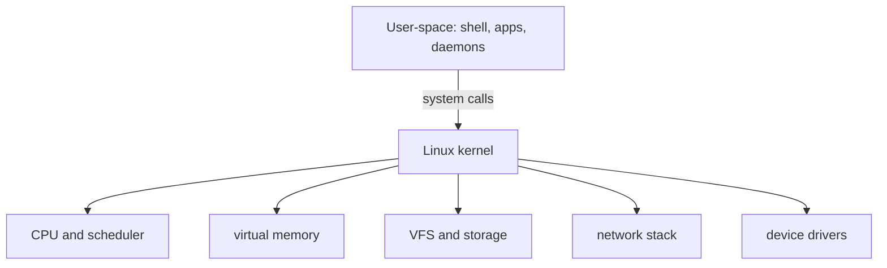
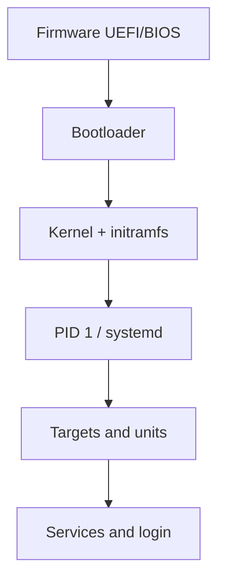

# Computer, Operating System, and Linux Kernel

[← Home](../README.md) · [Next: Networking →](02-networking-dns-http-tls.md)

## The mental model

Hardware provides CPU, memory, disks, network interfaces, clocks, and devices. The kernel safely multiplexes those resources. User-space programs ask the kernel for work through system calls.



### Kernel space versus user space

- Kernel space is privileged. A kernel bug can crash or compromise the entire host.
- User space is isolated by virtual memory and process credentials.
- A system call such as `openat`, `read`, `write`, `socket`, `connect`, or `clone` crosses the boundary in a controlled way.
- Libraries may wrap system calls. A program can make many library calls without entering the kernel every time.

## Process model

A process is more than a PID. It has:

- one or more threads scheduled on CPUs;
- virtual address space and memory mappings;
- file descriptors for files, sockets, pipes, devices, and event objects;
- UID/GID and capabilities used for permission checks;
- environment, arguments, working directory, resource limits, and namespaces;
- a parent relationship and an exit status.

Useful views:

```bash
ps -eo pid,ppid,user,stat,%cpu,%mem,cmd --sort=-%cpu
cat /proc/<PID>/status
ls -l /proc/<PID>/fd
cat /proc/<PID>/cgroup
```

`fork`/`clone` creates execution context; an `exec` family call replaces the current program image. A zombie has exited but its parent has not collected its status. An orphan is reparented to a subreaper or PID 1.

## CPU scheduling and load

- The scheduler selects runnable threads; a process “using CPU” means its threads receive CPU time.
- Load average counts runnable tasks and tasks in uninterruptible sleep, not simply CPU percentage.
- High load with low CPU can indicate blocked I/O.
- Context switches are normal; excessive switching may indicate contention, too many runnable tasks, or lock behavior.

Do not diagnose from one number. Correlate run queue, CPU modes, per-process usage, I/O latency, and pressure.

## Virtual memory

Each process sees a virtual address space. The kernel and MMU map virtual pages to physical memory or backing storage.

Important concepts:

- anonymous memory: heap, stacks, and non-file mappings;
- page cache: file data cached in RAM; “used” RAM is not automatically bad;
- RSS: resident pages currently in physical memory;
- swap: extends reclaim choices but heavy swapping can cause latency collapse;
- page fault: mapping/data was not immediately available; minor and major faults differ;
- OOM killer: last-resort selection when memory cannot be reclaimed under constraints.

In containers, cgroup limits can cause a cgroup-local OOM even when the host has free memory.

## Filesystems and VFS

The Virtual Filesystem Switch provides a common interface over ext4, XFS, tmpfs, NFS, procfs, and others.

| Object | Meaning |
|---|---|
| inode | metadata and pointers for a filesystem object; filename is not stored as its identity |
| directory entry | mapping from a name to an inode |
| hard link | another directory entry for the same inode |
| symbolic link | a separate file containing a path |
| mount | attaches a filesystem tree at a directory |
| file descriptor | per-process handle to an open kernel object |

Deleting a filename unlinks a directory entry. Disk space may remain used while a process still holds the file open; inspect with `lsof +L1`.

## Boot flow



Know where to inspect each stage: firmware/console, bootloader configuration, kernel command line, initramfs, `journalctl -b`, failed units, and service logs.

## Virtual machines versus containers

| VM | Container |
|---|---|
| virtual hardware and guest kernel | host kernel with isolated processes |
| stronger default isolation boundary | lighter and faster startup |
| boots an OS | starts a process |
| resources virtualized by hypervisor | resources isolated/limited by namespaces and cgroups |

Containers use Linux namespaces for scoped views, cgroups for accounting/limits, capabilities and LSMs for privilege control, and layered filesystems for image composition. They are not “small VMs.”

## Interview proof

Be able to explain:

1. why free memory can be low on a healthy Linux host;
2. why deleting a large log may not free disk immediately;
3. the difference between process, thread, PID, and file descriptor;
4. how a container can OOM while the host has available RAM;
5. what happens between firmware and a running systemd service.

Sources: [Linux kernel administrator guide](https://docs.kernel.org/admin-guide/), [cgroup v2](https://docs.kernel.org/admin-guide/cgroup-v2.html), [Linux namespaces](https://man7.org/linux/man-pages/man7/namespaces.7.html).
