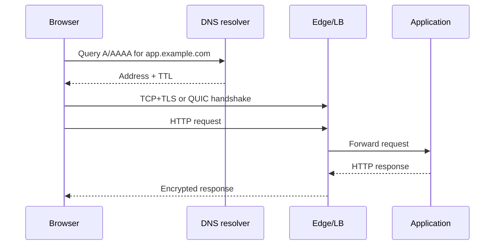
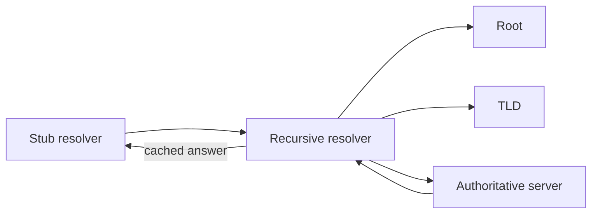

# Networking, DNS, HTTP, and TLS

[← OS and kernel](01-computer-os-linux-kernel.md) · [Next: Git →](03-git-and-collaboration.md)

## Follow one web request



At each step ask: what address, port, protocol, state, timeout, and evidence exist?

## Layered model

| Practical layer | Examples | Data/addressing focus |
|---|---|---|
| Application | DNS, HTTP, SSH, SMTP | names, methods, status, application data |
| Transport | TCP, UDP, QUIC | ports and connections/flows |
| Internet/network | IPv4, IPv6, ICMP | IP addresses and routes |
| Link | Ethernet, Wi-Fi, ARP/ND | frames and local-link addresses |
| Physical | copper, fiber, radio | bits/signals |

OSI is a teaching model. Real protocols can cross or combine its boundaries; use it to localize failures, not force every feature into exactly one box.

## IP, CIDR, and routing

An IP address identifies an interface in a routing scope. It is not a permanent globally unique device identity.

- IPv4 uses 32 bits; IPv6 uses 128 bits.
- A CIDR prefix such as `192.0.2.0/24` identifies the leading network bits.
- A routing table chooses the most specific matching prefix; then metric/policy breaks ties.
- The default route (`0.0.0.0/0` or `::/0`) is used when no more specific route matches.
- A default gateway must be reachable on a directly connected link.

For IPv4 subnet size, total addresses are `2^(32-prefix)`. Traditional subnet network and broadcast addresses are not usable host addresses, but cloud providers may reserve additional addresses. `/31` has point-to-point semantics; `/32` identifies one address.

## Local delivery and routing

If the destination is on-link, the host resolves a link-layer neighbor using ARP (IPv4) or Neighbor Discovery (IPv6). Otherwise it sends the frame to a router's link address while the IP destination remains the remote host.

Useful evidence:

```bash
ip address
ip route
ip neigh
ss -lntup
dig app.example.com A
curl -v https://app.example.com/
```

## TCP, UDP, and QUIC

TCP offers an ordered reliable byte stream with connection state, acknowledgements, retransmission, flow control, and congestion control. Its three-way handshake is SYN → SYN-ACK → ACK.

UDP sends independent datagrams without TCP's reliability or connection semantics. Applications may add their own reliability.

QUIC runs over UDP and combines secure transport, streams, congestion control, and fast connection establishment. HTTP/3 uses QUIC; therefore “HTTP always uses TCP” is incorrect.

## DNS

DNS is a distributed, cached, hierarchical database of typed records.



Common records:

| Record | Purpose |
|---|---|
| A / AAAA | name to IPv4 / IPv6 address |
| CNAME | alias to another canonical name |
| MX | mail exchanger plus priority |
| TXT | arbitrary text; often ownership and mail policies |
| NS | authoritative servers for a zone/delegation |
| SOA | zone authority and timing metadata |
| PTR | reverse address-to-name mapping |
| SRV | service location including port and priority |
| CAA | which certificate authorities may issue |

TTL controls cache lifetime, not propagation as a magical global event. Negative answers can also be cached. Delegation, authoritative data, resolver cache, local hosts files, and application caches are separate failure points.

## HTTP semantics

A request has method, target, protocol version, headers, and optionally a body. A response has version, status, headers, and optionally a body.

- Safe methods should not request state change (`GET`, `HEAD`, `OPTIONS`).
- Idempotent means repetition has the same intended effect (`PUT`, `DELETE` are defined as idempotent; `POST` generally is not).
- `2xx` success, `3xx` redirection, `4xx` client/request issue, `5xx` server-side failure.
- `Host`/`:authority`, content negotiation, authentication, caching, cookies, and tracing context live in headers.
- Timeouts exist at client, proxy, load balancer, application, and downstream layers; mismatched timeouts create confusing failures.

## TLS and PKI

TLS authenticates endpoints (usually the server), negotiates algorithms/keys, and protects confidentiality and integrity in transit.

The client validates:

1. certificate time validity;
2. requested hostname against SAN entries;
3. signature chain to a trusted CA;
4. policy/revocation behavior as implemented;
5. handshake and key agreement.

TLS does not make the application authorized or bug-free. Terminating TLS at a load balancer creates a new trust boundary; decide whether backend traffic also requires TLS/mTLS.

## Troubleshooting ladder

1. Interface/link: is it up and addressed?
2. Route: which path will the kernel choose?
3. Neighbor/gateway: can the next hop be resolved/reached?
4. DNS: is the answer correct from the intended resolver?
5. Transport: is the port listening and reachable?
6. TLS: hostname, chain, time, protocol, SNI?
7. HTTP: method, host, path, status, headers, timeout?
8. Application/downstream: logs, traces, dependencies?

Never begin with “the network is down.” State the failing layer and evidence.

Sources: [HTTP Semantics RFC 9110](https://www.rfc-editor.org/rfc/rfc9110), [QUIC RFC 9000](https://www.rfc-editor.org/rfc/rfc9000), [DNS concepts RFC 1034](https://www.rfc-editor.org/rfc/rfc1034).

