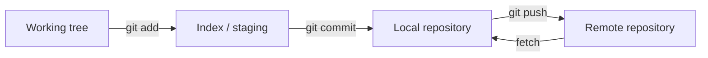

# Git and Collaboration

[← Networking](02-networking-dns-http-tls.md) · [Next: Scripting →](04-scripting-and-data-formats.md)

## Git's three useful views



Git stores content snapshots connected by commits. A branch is a movable name pointing to a commit. `HEAD` identifies the checked-out commit/branch. A remote-tracking branch such as `origin/main` is your local record of the remote's state after fetch.

## Daily safe flow

```bash
git status
git fetch --prune
git switch -c feature/short-name
git add <intentional-paths>
git diff --cached
git commit -m "Explain the outcome"
git push -u origin feature/short-name
```

Review staged changes before committing. Do not use `git add .` blindly in a workspace that may contain credentials, build outputs, or unrelated edits.

## Merge, rebase, reset, revert

| Operation | Effect | Safe use |
|---|---|---|
| merge | creates or advances history combining lines | shared branches; preserves topology |
| rebase | replays commits on another base | clean private feature history before review |
| revert | new commit that undoes an earlier commit | preferred undo on shared history |
| reset | moves a branch/index and may affect files | local correction; understand mode first |

Never force-push shared branches without an explicit team agreement. Prefer `--force-with-lease` over unconditional force when rewriting your own remote branch.

## Conflict method

1. Read the entire conflicting file and understand both intentions.
2. Choose the desired final behavior—not merely “ours” or “theirs.”
3. Remove conflict markers.
4. Run tests and inspect the diff.
5. Continue the merge/rebase and explain the resolution in review.

## Good repository controls

- protected main branch;
- pull requests with review and required checks;
- small changes that can be independently tested and reverted;
- secret scanning and `.gitignore`, without assuming ignore removes already-tracked data;
- signed commits/tags or build provenance where risk requires it;
- release tags and immutable artifacts;
- ownership rules for sensitive paths;
- automated dependency and vulnerability updates with tests.

## Git is not a secret store

Deleting a secret from the latest file does not erase it from history. Treat exposed credentials as compromised: revoke/rotate them first, then clean history if needed, and coordinate force updates.

## Interview proof

Explain how you would:

- recover a bad production commit without rewriting shared history;
- bring a feature branch up to date and resolve conflicts;
- find when a line changed (`git log -S`, `git blame` as clues, not proof of fault);
- keep generated artifacts out of Git while preserving reproducible builds;
- design branch protections for a small team.

Source: [official Git documentation](https://git-scm.com/docs).

