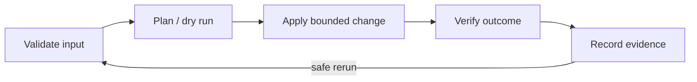

# Scripting, Automation, and Data Formats

[← Git](03-git-and-collaboration.md) · [Next: APIs and proxies →](05-apis-proxies-load-balancers.md)

## Choose the smallest reliable tool

| Need | Good starting choice |
|---|---|
| interactive Linux task or small glue | shell |
| structured automation, APIs, testing | Python, Go, or Rust |
| configuration | YAML/TOML/JSON depending tool |
| event logs | structured JSON Lines |
| metrics | time-series protocol/backend, not JSON files |
| traces | OpenTelemetry/OTLP, not hand-built text files |
| human report | Markdown |
| compatibility/exchange | XML only when required |

## Robust shell baseline

```bash
#!/usr/bin/env bash
set -Eeuo pipefail

main() {
  local config_path=${1:?usage: script CONFIG_PATH}
  [[ -r "$config_path" ]] || {
    printf 'config is not readable: %s\n' "$config_path" >&2
    return 1
  }
  # Perform one bounded, observable operation.
}

main "$@"
```

Principles:

- quote variable expansions unless intentional word splitting is required;
- prefer arrays for lists of arguments;
- avoid parsing `ls`; use globs or `find` with null delimiters;
- use `mktemp -d` and a trap for temporary data;
- make failure visible and return non-zero;
- log actions without logging secrets;
- validate the exact target before mutation;
- design reruns to be safe (idempotent or explicitly resumable);
- use ShellCheck and tests.

## Exit codes and streams

- Exit code 0 conventionally means success; non-zero means a defined failure.
- stdout is normal/machine-consumable output; stderr is diagnostics.
- Pipes connect stdout of one process to stdin of another. `pipefail` prevents an early pipeline failure from being hidden by a later success.

## Data formats

| Format | Strength | Common trap |
|---|---|---|
| JSON | strict, universal API/data exchange | no comments; duplicate keys and large numbers can be tricky |
| JSONL | one JSON object per line; streaming logs | each line must independently parse |
| YAML | readable configuration and multi-document support | implicit typing, indentation, duplicate keys, unsafe templating |
| TOML | clear typed configuration | less common in orchestration tools |
| Markdown | durable human explanation | not a database or enforcement format |
| CSV | simple tabular exchange | quoting, delimiters, encoding, types, embedded newlines |
| XML | schemas, namespaces, mature enterprise interchange | verbosity and parser security if misconfigured |

Validate at the boundary. YAML is a serialization format, not an orchestration language; Kubernetes and Ansible give YAML documents their meaning through schemas and engines.

## Automation design



Every production automation should state:

- preconditions and permissions;
- exact scope and blast radius;
- dry-run/plan behavior;
- timeout, retry, and backoff policy;
- idempotency semantics;
- rollback or forward-fix strategy;
- logs/metrics and audit trail;
- secret source and redaction behavior.

## When shell is no longer enough

Move to a typed/testable program when parsing complex structures, concurrency, API clients, long-lived daemons, cross-platform behavior, or critical error handling dominate the script. A 500-line shell script is not automatically wrong, but its quoting, state, and test burden is usually a warning.
