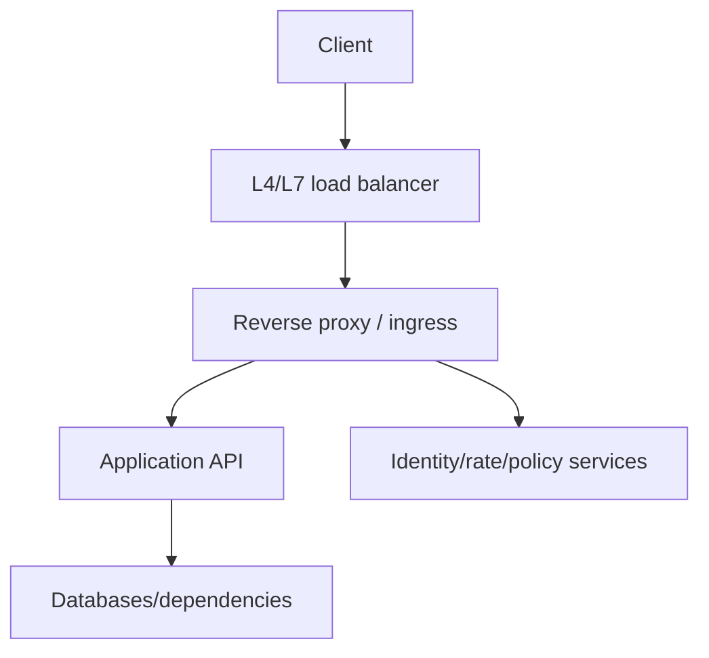

# APIs, Reverse Proxies, API Gateways, and Load Balancers

[← Scripting](04-scripting-and-data-formats.md) · [Next: Security foundations →](06-security-cryptography-foundations.md)

## Separate the roles



| Component | Primary job |
|---|---|
| forward proxy | acts for clients; controls/caches outbound access |
| reverse proxy | acts in front of servers; TLS, routing, headers, caching, protection |
| load balancer | distributes connections/requests among healthy targets |
| API gateway | API-focused entry: authentication, quotas, transformations, routing, analytics |
| service mesh | service-to-service traffic policy/identity/telemetry through data/control planes |

Products can combine roles. Explain behavior, not only product name.

## REST-style API basics

REST is an architectural style, not “JSON over HTTP.” Useful HTTP API design includes:

- resources and stable identifiers;
- correct method semantics and status codes;
- idempotency for retried writes where needed;
- authentication and resource-level authorization;
- input validation and bounded payloads;
- pagination/filtering/sorting;
- version/compatibility and deprecation policy;
- request IDs and trace context;
- timeouts, rate limits, error contract, documentation.

### Idempotency

A retried `POST` may create duplicates. For payment/order/create operations, accept an idempotency key scoped to caller/operation, persist outcome, and return the same result for safe retries. Define expiry and conflict behavior.

## Proxy trust and headers

A backend may see the proxy's connection address. Forwarded headers (`Forwarded`, `X-Forwarded-*`) are trustworthy only when received from known proxies and sanitized at the boundary. Otherwise clients can spoof scheme/IP/host and affect redirects, logging, or authorization.

Set and understand:

- allowed hostnames and SNI;
- request/body/header size limits;
- connect, read, write, idle, and total deadlines;
- retry policy and idempotency;
- buffering/streaming behavior;
- WebSocket/gRPC/HTTP version support;
- client IP handling;
- TLS termination and backend encryption.

## Load-balancing algorithms

Round-robin, least-connections, hashing, and weighted policies fit different traffic. Health checks remove targets only based on their check contract. Session affinity can help stateful legacy applications but complicates balancing/failover; prefer externalized state when possible.

## Nginx mental model

Nginx commonly listens on sockets, selects a server block by address/SNI/Host, selects a location, then serves static content or proxies upstream. Effective configuration, includes, DNS resolution behavior, worker limits, buffering, and upstream timeouts matter.

Safe investigation:

```bash
nginx -t
nginx -T
ss -lntup
curl -v -H 'Host: app.example.com' http://127.0.0.1/
```

Reload after config validation; a reload generally starts new workers with new config while old workers drain, but application/backend compatibility still matters.

## Failure patterns

| Symptom | Investigate |
|---|---|
| 502 | proxy could not obtain valid upstream response: connect/refused/reset/protocol |
| 503 | no healthy/capable upstream or intentional unavailable response |
| 504 | upstream did not respond within gateway deadline |
| redirect loop | scheme/host forwarding and TLS termination trust |
| uneven load | long connections, affinity, weights, health, algorithm |
| client timeout but backend completes | deadline mismatch and abandoned work |

Status meanings vary by implementation and context; inspect proxy and upstream evidence with a request ID/trace.

## Interview proof

Explain forward versus reverse proxy, L4 versus L7 balancing, 502 versus 504, trusted forwarded headers, API idempotency, and why retries must fit deadlines.

Source: [HTTP Semantics RFC 9110](https://www.rfc-editor.org/rfc/rfc9110) and [Nginx documentation](https://nginx.org/en/docs/).
