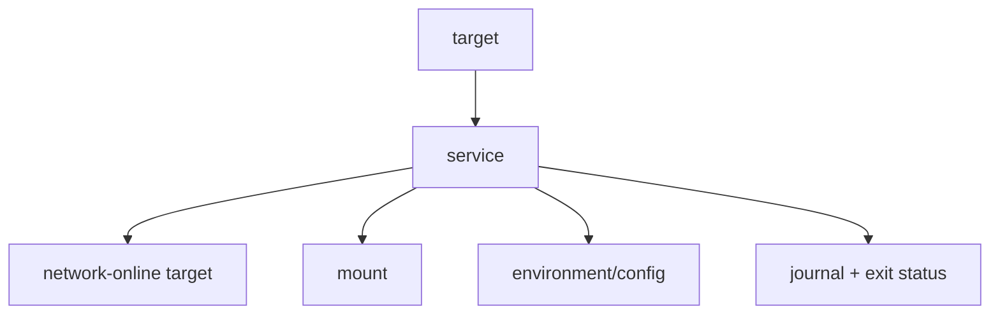
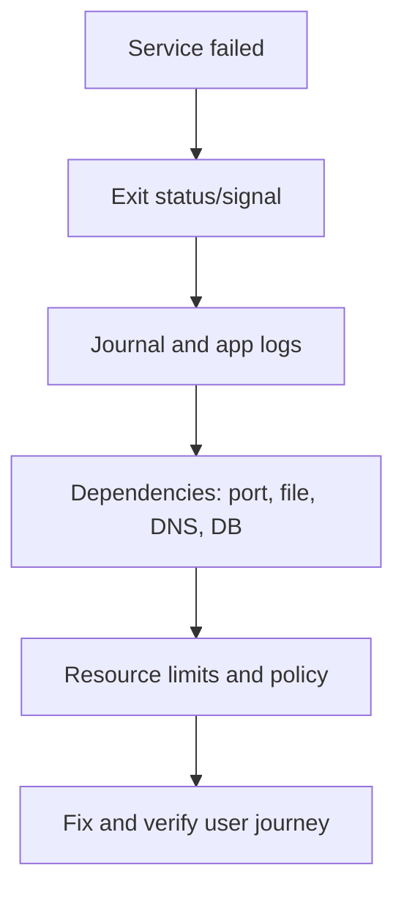

# Processes, systemd, Packages, and Logs

[← Identity](01-users-permissions-sudo.md) · [Next: Storage →](03-storage-filesystems-lvm.md)

## systemd mental model

systemd manages units and their dependencies. A service unit is not merely a startup script; it declares execution, identity, dependencies, restart policy, resource control, and sandboxing.



Important distinctions:

- `Wants=` is a weaker dependency; `Requires=` stops/starts more tightly.
- `After=` controls order, not whether another unit is pulled in.
- `network.target` does not guarantee usable external connectivity; even `network-online.target` depends on the network stack's wait service and should be used deliberately.
- `Restart=on-failure` is often safer than unconditional restart; restart loops can hide permanent misconfiguration.

## Service investigation

```bash
systemctl status example.service
systemctl cat example.service
systemctl show example.service
journalctl -u example.service -b
journalctl -u example.service --since '30 min ago'
systemd-analyze critical-chain
```

When using `systemctl edit`, saving an empty drop-in creates no override. Put only overridden directives inside the correct section, then `systemctl daemon-reload` and restart/reload as required.

## A production-oriented unit skeleton

```ini
[Unit]
Description=Example API
After=network-online.target
Wants=network-online.target

[Service]
Type=simple
User=example
Group=example
ExecStart=/usr/local/bin/example-api --config /etc/example/config.yaml
Restart=on-failure
RestartSec=5s
NoNewPrivileges=yes
PrivateTmp=yes
ProtectSystem=strict
ProtectHome=yes
ReadWritePaths=/var/lib/example
StateDirectory=example

[Install]
WantedBy=multi-user.target
```

Sandbox settings must be tested with the application; apply them intentionally rather than copying blindly.

## Signals and shutdown

Processes receive signals. `SIGTERM` requests graceful termination and can be handled; `SIGKILL` cannot. A graceful service should stop accepting new work, finish or checkpoint bounded work, flush state/telemetry, and exit before the supervisor timeout.

## Packages and repositories

- Debian/Ubuntu commonly use APT/dpkg; RHEL-family systems use DNF/RPM.
- A repository provides metadata and signed packages. Verify repository ownership, signing keys, support for the OS release, and pin/version policy.
- Avoid piping unknown network scripts into a privileged shell.
- “Latest” hurts reproducibility; security patching still requires a deliberate update policy.
- Know configuration, state, logs, and binary locations before upgrading.

## Logging model

Logs are evidence, not the system's entire state. A useful structured event includes timestamp, severity, service, environment, event name, request/trace ID, outcome, duration, and bounded error context.

Never log passwords, tokens, private keys, full authorization headers, or unnecessary personal data.

The journal can index metadata and preserve stdout/stderr for services. Applications in containers usually write logs to stdout/stderr and let the runtime/collector ship them. Rotation/retention must be explicit; unlimited local logs can fill the disk and cause a secondary outage.

## Failure flow



## Interview proof

Explain a restart loop, how `After` differs from `Requires`, how to find the effective unit after drop-ins, and how you would deploy an update with rollback and log retention.
