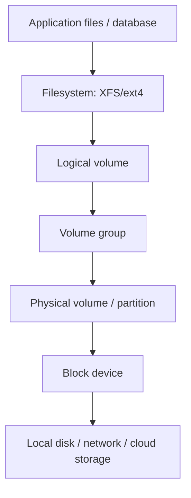

# Storage, Filesystems, LVM, and Backups

[← systemd](02-processes-systemd-logs.md) · [Next: Network security →](04-networking-ssh-firewall.md)

## Stack mental model



Not every host uses LVM, but always identify the real layers before changing capacity.

## Inspect before changing

```bash
lsblk -f
findmnt
df -hT
df -ih
sudo pvs
sudo vgs
sudo lvs -a -o +devices
```

`df` reports filesystem space; `du` walks reachable directory entries. They differ when deleted-open files exist, mounts hide data, sparse files exist, permissions prevent traversal, or snapshots/reserved blocks are involved.

## Capacity and failure modes

| Symptom | Likely checks |
|---|---|
| 100% blocks | large files, deleted-open files, logs, snapshots, reserved space |
| free blocks but cannot create files | inode exhaustion, quota, permissions, read-only filesystem |
| I/O slow | latency, queue depth, saturation, errors, network storage, fsync pattern |
| filesystem read-only | kernel/storage errors; inspect logs before remounting |
| mount missing after reboot | `/etc/fstab`, UUID, dependencies, network-online behavior |

## LVM expansion reasoning

The safe direction is generally: detect new block capacity → update/initialize PV as appropriate → extend VG/LV → grow filesystem using its supported tool → verify. Exact commands depend on whether a partition grew, a new disk was added, the filesystem is XFS or ext4, encryption exists, and snapshots are present.

Never copy an LVM command before confirming device paths, backups, filesystem support, and the intended target. Shrinking is much riskier and XFS cannot be shrunk in place.

## Storage types

| Type | Good for | Important trade-off |
|---|---|---|
| local block | low latency, host-bound workloads | host failure/mobility |
| network block | VM/database volumes, snapshots | attach limits, zone, latency |
| shared filesystem/NFS | shared files, RWX workloads | identity mapping, locking, server dependency |
| object storage | durable objects, backups, data lake | not POSIX; higher latency/different consistency semantics |
| tmpfs | fast sensitive/temporary data | consumes memory; lost on stop/reboot |

## Backups are a recovery system

A copy is not a proven backup until restore is tested.

- RPO: maximum acceptable data loss measured in time.
- RTO: maximum acceptable restoration time.
- Crash-consistent and application-consistent snapshots differ.
- Database backups require database-aware procedures and transaction-log/WAL strategy.
- Keep copies in a separate failure/security domain; protect backup deletion.
- Encrypt, control access, verify checksums, monitor jobs, and rehearse restoration.

The 3-2-1 pattern is a useful starting heuristic: multiple copies, different media/failure domains, and one offsite/offline/isolated copy. Tailor it to threat model and service objectives.

## Kubernetes/NFS lesson from your notes

When a stateful Pod cannot initialize an NFS-backed directory, check the container's numeric UID/GID, volume ownership, `fsGroup` behavior, NFS export options/root squash, security context, SELinux labels, and storage-class semantics. A permissive mode change may hide the mechanism and create a security risk.

## Interview proof

Explain `df` versus `du`, inode exhaustion, deleted-open files, block versus object storage, safe expansion layers, and how RPO/RTO influence backup design.

