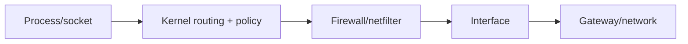

# Linux Networking, SSH, Firewalls, and Host Security

[← Storage](03-storage-filesystems-lvm.md) · [Next: Performance →](05-performance-troubleshooting.md)

## Host traffic path



For inbound traffic the order is reversed before a listening socket accepts it. Containers and Kubernetes add namespaces, virtual Ethernet, bridges, NAT/service rules, and policy.

## Inspect the host

```bash
ip -br address
ip route get 198.51.100.10
ss -lntup
resolvectl status 2>/dev/null || cat /etc/resolv.conf
curl -v --connect-timeout 5 https://example.com/
```

Use `tcpdump` only with authorization and a bounded filter. Packet captures may contain credentials or personal data and should have controlled retention.

## Stateful firewall mental model

A stateful firewall tracks flows and can permit return traffic for established connections. “Port open” can mean a process listens, host firewall accepts, cloud firewall/security group accepts, routing reaches the host, and upstream ACL allows it—each is separate.

With firewalld, understand active zone, interface/source assignment, runtime versus permanent configuration, services/ports, rich rules, and reload behavior. With nftables, understand tables, chains, hooks, priorities, matches, and verdicts.

Default-deny inbound plus explicitly allowed management and application paths is a good baseline. Egress control matters for high-risk workloads but requires DNS, update, telemetry, and dependency planning.

## SSH trust model

- The client authenticates the server using its host key (`known_hosts`).
- The server authenticates the user using keys, certificates, MFA, or other configured methods.
- Authorization depends on account, `authorized_keys`, SSH certificate principals, policy, and filesystem permissions.

Host-key warnings should not be bypassed blindly; verify whether the host was rebuilt, DNS/IP changed, or a man-in-the-middle risk exists.

Host hardening baseline:

- disable direct root login unless a justified controlled exception exists;
- prefer keys/certificates and MFA over reusable passwords;
- restrict users/groups and source networks;
- keep emergency access separate and tested;
- use bastion/IAP/VPN or zero-trust access where appropriate;
- log access and protect private keys;
- use short-lived identity where the platform supports it.

## SELinux/AppArmor

Discretionary permissions answer “does this UID/GID/mode allow it?” Mandatory access control adds policy based on labels/profiles. On SELinux systems:

```bash
getenforce
ls -Z /path
ps -eZ | head
sudo ausearch -m AVC -ts recent
```

Do not permanently disable enforcement to make an application work. Identify the denied operation, correct labels/booleans/policy, and retest.

## Network troubleshooting sequence

1. Confirm source and destination endpoints.
2. Confirm listener and bind address (`127.0.0.1` versus `0.0.0.0`/`::`).
3. Resolve DNS from the actual environment.
4. Inspect route and next hop.
5. Test transport with timeout.
6. Inspect host and cloud firewall counters/logs.
7. Capture a bounded packet trace if ambiguity remains.
8. Validate TLS and application protocol.

## Interview proof

Be ready to diagnose “SSH timeout,” “connection refused,” “TLS hostname mismatch,” and “works on localhost but not remotely” as different mechanisms.

