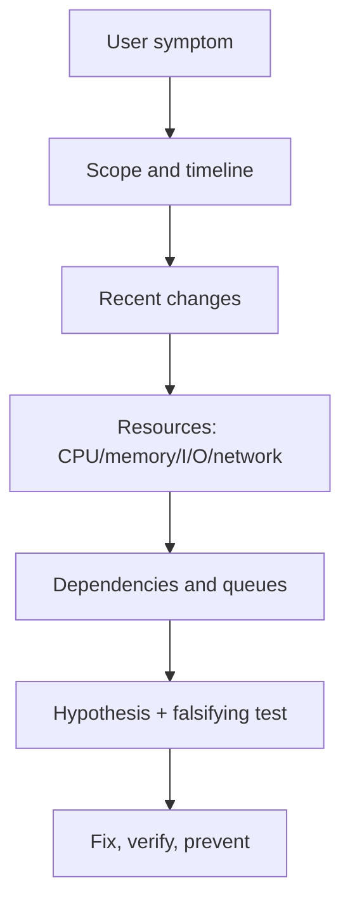

# Linux Performance and Troubleshooting Method

[← Host security](04-networking-ssh-firewall.md) · [Containers →](../03-containers/01-container-internals.md)

## Start with scope and time

Before a command, state:

- what is slow or unavailable from the user's view;
- when it began and whether it is continuous or periodic;
- which hosts/services/regions are affected;
- the most recent changes;
- what “normal” baseline looks like.

## Evidence ladder



## USE and RED

- USE for resources: utilization, saturation, errors.
- RED for request-driven services: rate, errors, duration.

These are investigation frameworks, not universal dashboards. User-relevant SLIs still decide service reliability.

## First 60 seconds

```bash
uptime
free -h
vmstat 1 5
pidstat 1 5
iostat -xz 1 5
df -hT
df -ih
ss -s
systemctl --failed
journalctl -p warning -b --since '30 min ago'
```

Tools may require packages. Do not run high-overhead profiling indefinitely on production.

## Interpret patterns

| Evidence | Possible mechanism | Next proof |
|---|---|---|
| high user CPU | application computation | per-thread profile, flame graph, workload change |
| high system CPU | kernel/network/I/O overhead | syscall/network/block evidence |
| high run queue | CPU saturation or uninterruptible tasks | CPU modes, task states, I/O latency |
| swap in/out and memory PSI | reclaim pressure/thrashing | cgroups, RSS, page cache, OOM logs |
| high disk await/queue | storage saturation or fault | device/service latency, errors, I/O pattern |
| packet retransmits | loss/congestion/path issue | interface counters and bounded packet capture |
| many connections in a state | timeout/backlog/peer behavior | socket ownership, application limits, upstream health |

Average CPU and average latency hide tails. Inspect percentiles and per-core/per-device/per-cgroup distributions.

## Pressure Stall Information

Linux PSI exposes time tasks are delayed waiting for CPU, memory, or I/O. It helps distinguish “resource is utilized” from “work is actually stalled.” Inspect `/proc/pressure/{cpu,memory,io}` where supported and correlate with cgroup/service data.

## Change discipline

During an incident:

- preserve evidence before restarting when safe;
- change one bounded variable when possible;
- record timestamp and expected effect;
- prefer reversible mitigation;
- verify the user journey, not only a green process;
- create follow-up work for the actual root cause.

## Five common traps

1. Restarting until symptoms disappear, losing root-cause evidence.
2. Treating correlation as causation.
3. Blaming “network” or “database” without a failing operation.
4. Scaling a memory leak or retry storm and increasing blast radius.
5. Ignoring time synchronization, quotas, certificates, and recent config changes.

## Interview answer structure

“I would first define scope and timeline, check recent changes, validate the user path, examine resource and dependency saturation, form ranked hypotheses with falsifying tests, apply the smallest safe mitigation, verify recovery, then record root cause and prevention.”

