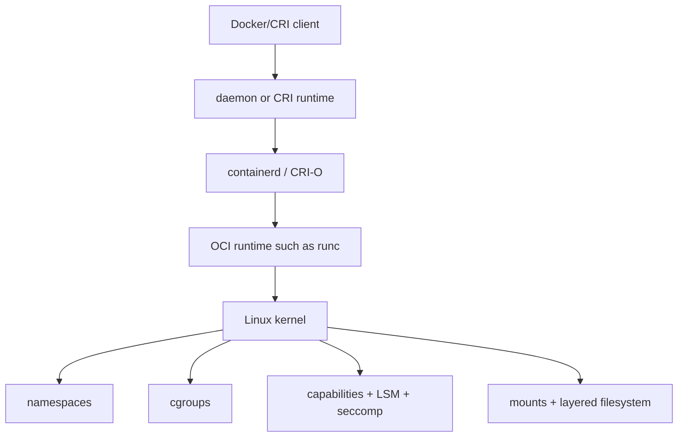

# Container Internals

[← Linux troubleshooting](../02-linux-administration/05-performance-troubleshooting.md) · [Next: Docker build →](02-docker-images-dockerfile-compose.md)

## A container is an isolated process arrangement

The image supplies a root filesystem and configuration. The host kernel creates the process and isolation. That is why a Linux container cannot bring its own unrelated kernel in the same way a VM can.

## Namespaces

| Namespace | Isolates the view of |
|---|---|
| PID | process IDs and hierarchy |
| mount | mount points/filesystem view |
| network | interfaces, routes, sockets, ports, firewall state |
| UTS | hostname/domain name |
| IPC | shared memory, semaphores, queues |
| user | mappings of UIDs/GIDs and capabilities |
| cgroup | view of cgroup hierarchy |
| time | selected clock offsets |

Namespaces isolate views; they do not automatically impose resource limits.

## cgroups

cgroup v2 organizes processes hierarchically and accounts/controls resources such as CPU, memory, I/O, and PIDs. A limit is not a reservation. Kubernetes requests influence scheduling; limits are enforced by runtime/kernel mechanisms depending on resource type.

Examples of mechanisms:

- CPU quota throttles execution time;
- memory max can trigger cgroup OOM;
- PID limits prevent fork bombs;
- I/O controls influence bandwidth/IOPS priorities/limits where supported.

## Capabilities, seccomp, and LSMs

Root traditionally holds broad privilege. Linux capabilities split parts of it, but some—especially `CAP_SYS_ADMIN`—remain very powerful. Start from the runtime default, drop capabilities, add only those proven necessary, use `no-new-privileges`, a restrictive seccomp profile, and SELinux/AppArmor policy.

`--privileged` is a major boundary reduction, not a generic troubleshooting flag.

## Layered filesystem and copy-on-write

Image layers are immutable and shared. A container gets a writable layer. Modifying an image file can trigger copy-up into the writable layer. This is convenient but not appropriate durable storage.

- stopping normally preserves the container layer;
- removing the container removes its writable layer unless data is in a volume/bind mount;
- volumes bypass image copy-on-write for persistent application data;
- image layers can retain deleted secrets from earlier build steps.

## PID 1 and signals

The first process in a container has special signal/reaping responsibilities. Use exec-form `ENTRYPOINT`/`CMD`, make the application handle termination, and use a small init only when needed. Shell-form entrypoints can intercept signals and make graceful shutdown unreliable.

## Container is not a security boundary by wish

Security depends on kernel, runtime, configuration, image provenance, mounted host resources, credentials, network paths, and patching. Mounting the Docker socket into a container usually grants control equivalent to root on the host.

## Interview proof

Explain how namespaces differ from cgroups, why root in a user namespace can be unprivileged outside it, why a cgroup OOM differs from host OOM, how images differ from containers, and why privileged/socket-mounted containers are risky.

Sources: [kernel cgroup v2 documentation](https://docs.kernel.org/admin-guide/cgroup-v2.html), [namespaces manual](https://man7.org/linux/man-pages/man7/namespaces.7.html), [Docker Engine security](https://docs.docker.com/engine/security/).

