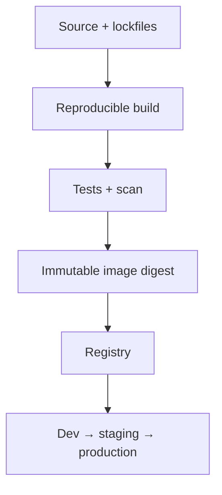

# Docker Images, Dockerfiles, and Compose

[← Internals](01-container-internals.md) · [Next: Operations →](03-storage-networking-security-troubleshooting.md)

## Build once, promote the same artifact



Do not rebuild different bytes for production. Promote the tested digest and change environment configuration separately.

## Dockerfile mental model

- `FROM` selects a base stage.
- `RUN` changes a build layer.
- `COPY`/`ADD` brings build-context content into the image; prefer `COPY` unless `ADD` behavior is intentionally needed.
- `ARG` is build-time metadata and not a safe secret mechanism.
- `ENV` persists runtime environment defaults.
- `USER` changes runtime identity for following build/runtime instructions.
- `ENTRYPOINT` defines the executable; `CMD` supplies default command/arguments.
- `EXPOSE` documents an intended port; it does not publish it on the host.
- `HEALTHCHECK` defines an image-level check when the runtime uses it.

## Secure, cache-efficient pattern

```dockerfile
# syntax=docker/dockerfile:1
FROM rust:bookworm AS build
WORKDIR /src
COPY Cargo.toml Cargo.lock ./
COPY src ./src
RUN --mount=type=cache,target=/usr/local/cargo/registry \
    cargo build --locked --release

FROM debian:bookworm-slim
RUN useradd --system --uid 10001 --no-create-home app
COPY --from=build /src/target/release/example /usr/local/bin/example
USER 10001:10001
ENTRYPOINT ["/usr/local/bin/example"]
```

Production choices depend on required CA certificates, libc, timezone, debugging strategy, and vulnerability policy. “Smallest image” is not automatically “most operable.”

## Build best practices

- use trusted, supported base images and pin versions/digests according to update policy;
- rebuild frequently for patched dependencies;
- use multi-stage builds and remove compilers/package managers from runtime;
- keep build context small with `.dockerignore`;
- copy stable dependency files before frequently changing source to improve cache reuse;
- use BuildKit secret/SSH mounts rather than copying credentials;
- run as non-root and keep the filesystem read-only where possible;
- add OCI labels, SBOM/provenance, vulnerability scanning, and signing/attestation;
- test the image itself, not only source code.

## Tags versus digests

A tag is a movable human-friendly reference. A digest identifies exact content. Use semantic/build tags for discovery and digests for immutable deployment decisions. Avoid `latest` in production desired state.

## Compose model

Compose defines a multi-container application: services, networks, volumes, configs/secrets, health checks, dependencies, and resource settings.

```yaml
services:
  api:
    image: registry.example.com/api@sha256:REPLACE_WITH_DIGEST
    read_only: true
    tmpfs: [/tmp]
    ports: ["127.0.0.1:8080:8080"]
    environment:
      DATABASE_URL_FILE: /run/secrets/db_url
    secrets: [db_url]
    depends_on:
      db:
        condition: service_healthy
  db:
    image: postgres:REPLACE_WITH_SUPPORTED_VERSION
    volumes: [db-data:/var/lib/postgresql/data]
    healthcheck:
      test: ["CMD-SHELL", "pg_isready -U postgres"]
      interval: 10s
      timeout: 3s
      retries: 5
volumes:
  db-data: {}
secrets:
  db_url:
    file: ./secrets/db_url.txt
```

This is a teaching example; do not commit secret files. Compose `depends_on` can sequence readiness checks, but applications still need retries because dependencies can fail later.

## Common command intentions

```bash
docker compose config
docker compose pull
docker compose up -d
docker compose ps
docker compose logs --since 10m <service>
docker image inspect <image>
docker history --no-trunc <image>
```

Preview effective configuration before starting. Pin the project name/paths in automation so you operate the intended stack.

Source: [Docker build best practices](https://docs.docker.com/build/building/best-practices/) and [build-cache optimization](https://docs.docker.com/build/cache/optimize/).
