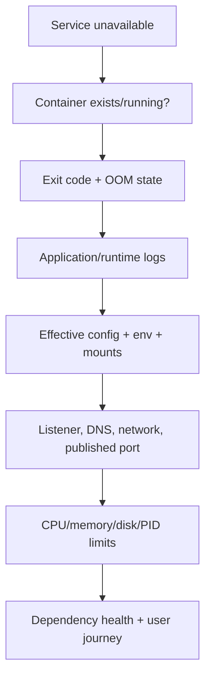

# Docker Storage, Networking, Security, and Troubleshooting

[← Docker build](02-docker-images-dockerfile-compose.md) · [Kubernetes →](../04-kubernetes/01-architecture-api-lifecycle.md)

## Storage choices

| Mechanism | Lifecycle / purpose |
|---|---|
| writable container layer | ephemeral container-specific changes; not durable application state |
| named volume | Docker-managed durable data |
| bind mount | explicit host path; strong host coupling and permission/security implications |
| tmpfs | memory-backed temporary data; lost on stop |

Storage driver manages image/container layers. Volumes and bind mounts are separate persistence mechanisms; they are not simply “stored by overlay2.”

For databases, define backup, consistency, UID/GID, filesystem, capacity, latency, and recovery behavior. A volume surviving container deletion is not a backup.

## Networking

- default/user-defined bridge gives containers private interfaces and host-mediated external access;
- user-defined networks provide embedded DNS/service-name discovery;
- published ports create host exposure; bind to `127.0.0.1` when only local access is needed;
- host mode shares the host network namespace and removes that isolation;
- none mode gives only loopback;
- overlay spans hosts in orchestration contexts;
- macvlan gives L2 presence but has host/reachability and network-operation trade-offs.

Inside a container, `localhost` means that container's network namespace, not the Docker host and not another container. Use the service name on a shared network.

## Security baseline

- non-root UID; rootless engine where compatible;
- do not mount the daemon socket;
- drop capabilities and avoid privileged mode;
- read-only root filesystem with explicit writable mounts;
- seccomp plus SELinux/AppArmor;
- secrets supplied at runtime, never image layers or Git;
- resource and PID limits;
- trusted/patched base and dependency policy;
- signed provenance/SBOM/scanning with risk-based enforcement;
- restricted network exposure and egress where feasible.

Rootless mode reduces daemon/runtime privilege but has networking, storage, and operational differences. It is one control, not a complete security solution.

## Troubleshooting flow



Useful commands:

```bash
docker ps -a
docker inspect <container>
docker logs --since 10m <container>
docker stats --no-stream
docker exec <container> sh -c 'id; ss -lntup 2>/dev/null || true'
docker network inspect <network>
docker volume inspect <volume>
docker events --since 10m
```

Prefer debugging images/namespaces externally when production images intentionally lack a shell.

## Common failures

| Symptom | Mechanism to check |
|---|---|
| container exits immediately | main process completed/crashed; exit code and stderr |
| works inside, not host | bind address, published port, firewall, host route |
| app cannot reach DB | `localhost` misuse, network membership, DNS, credentials, DB listener |
| permission denied on volume | numeric UID/GID, mode/ACL, SELinux label, mount flags |
| OOMKilled/restarted | cgroup memory limit, leak, working set, request burst |
| image changed unexpectedly | mutable tag rather than digest |
| disk full | logs, writable layers, build cache, unused images/volumes; verify ownership before cleanup |

Do not run broad prune commands during an incident without resolving exact targets and recovery impact.

Sources: [Docker rootless mode](https://docs.docker.com/engine/security/rootless/) and [Docker Engine security](https://docs.docker.com/engine/security/).

