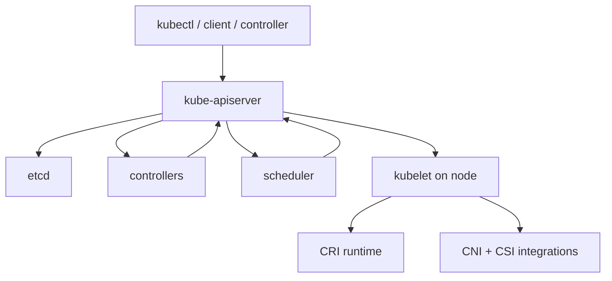
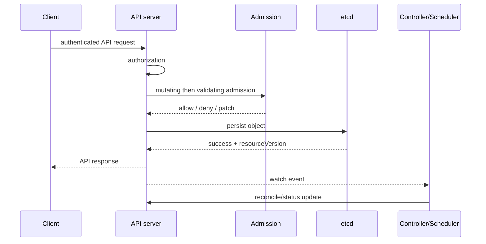

# Kubernetes Architecture and API Lifecycle

[← Containers](../03-containers/03-storage-networking-security-troubleshooting.md) · [Next: Workloads →](02-workloads-scheduling.md)

> Research snapshot: Kubernetes `1.36.2` was current on 7 August 2026. Always check the upstream release/support page.

## Kubernetes is an API-driven reconciliation system



- API server is the authenticated/authorized admission and persistence front door.
- etcd stores cluster API state; protect and back it up.
- controllers observe objects and act toward desired state.
- scheduler binds unscheduled Pods to suitable nodes.
- kubelet reconciles Pod specifications on its node through a CRI runtime.
- cloud-controller-manager integrates cloud-specific node, route, and load-balancer behavior.

Kubernetes does not eliminate operations. It moves many operations into control loops and APIs.

## One write request



Reads may be served with different consistency/caching semantics. Controllers commonly use LIST/WATCH caches. Objects have `metadata.resourceVersion`; updates can conflict when based on stale versions.

## Desired state, status, and ownership

- `spec` expresses desired behavior.
- `status` reports observed behavior and conditions.
- labels select/group objects; annotations store non-identifying metadata.
- owner references enable dependency/garbage-collection relationships.
- finalizers block deletion until a controller completes cleanup.
- managed fields record field ownership for server-side apply.

Deletion is often a lifecycle: deletion timestamp set → finalizers run → object removed.

## Controllers and operators

A controller is a control loop. An operator extends this pattern with custom resources and domain logic. A CRD adds an API type; it does not itself implement behavior. The controller is the behavior.

Good reconciliation is:

- level-based and idempotent;
- safe under repeated/out-of-order events;
- bounded with backoff;
- explicit about external state and finalizers;
- observable through conditions, events, metrics, and logs;
- least-privileged via RBAC.

## Runtime correction

Workers do not need Docker Engine. Kubernetes requires a CRI-conformant runtime. Dockershim was removed in 1.24; containerd and CRI-O are common choices. Images still follow OCI formats, so Docker-built images can run without Docker Engine.

## kubeconfig and client identity

A kubeconfig combines:

- `clusters`: API server address and CA trust;
- `users`: client certificate/token or an exec-based credential plugin;
- `contexts`: cluster + user + optional default namespace;
- `current-context`: selected context.

It does not create users or permissions in the cluster. The credential authenticates; Kubernetes authorization such as RBAC decides allowed actions.

```bash
kubectl config get-contexts
kubectl config current-context
kubectl auth can-i get pods -n example
```

Treat kubeconfig as sensitive because it may contain or invoke credentials. Prefer short-lived exec-plugin/cloud identity, narrow RBAC, and separate contexts. Before a mutation, print/confirm current context and namespace; similar cluster names are a common operator risk. Never paste real certificate/key/token data into notes.

## Cluster state and disaster recovery

High availability of control-plane components does not protect application data or guarantee disaster recovery. Plan:

- etcd snapshots and tested restoration;
- manifests/GitOps desired state;
- persistent-volume/application backups;
- certificate and KMS/key recovery;
- DNS/load-balancer dependencies;
- supported version upgrade paths;
- failure-domain and region strategy;
- documented recovery order and verification.

## Current-version corrections

- nftables kube-proxy mode is stable (since 1.33); IPVS mode is deprecated (since 1.35).
- Gateway API is the successor to the limited Ingress API and is installed/implemented separately.
- Check API removals/deprecations before upgrades; do not keep old `apiVersion` examples as timeless truth.

Sources: [Kubernetes releases](https://kubernetes.io/releases/), [container runtimes](https://kubernetes.io/docs/setup/production-environment/container-runtimes/), [API concepts](https://kubernetes.io/docs/reference/using-api/).
