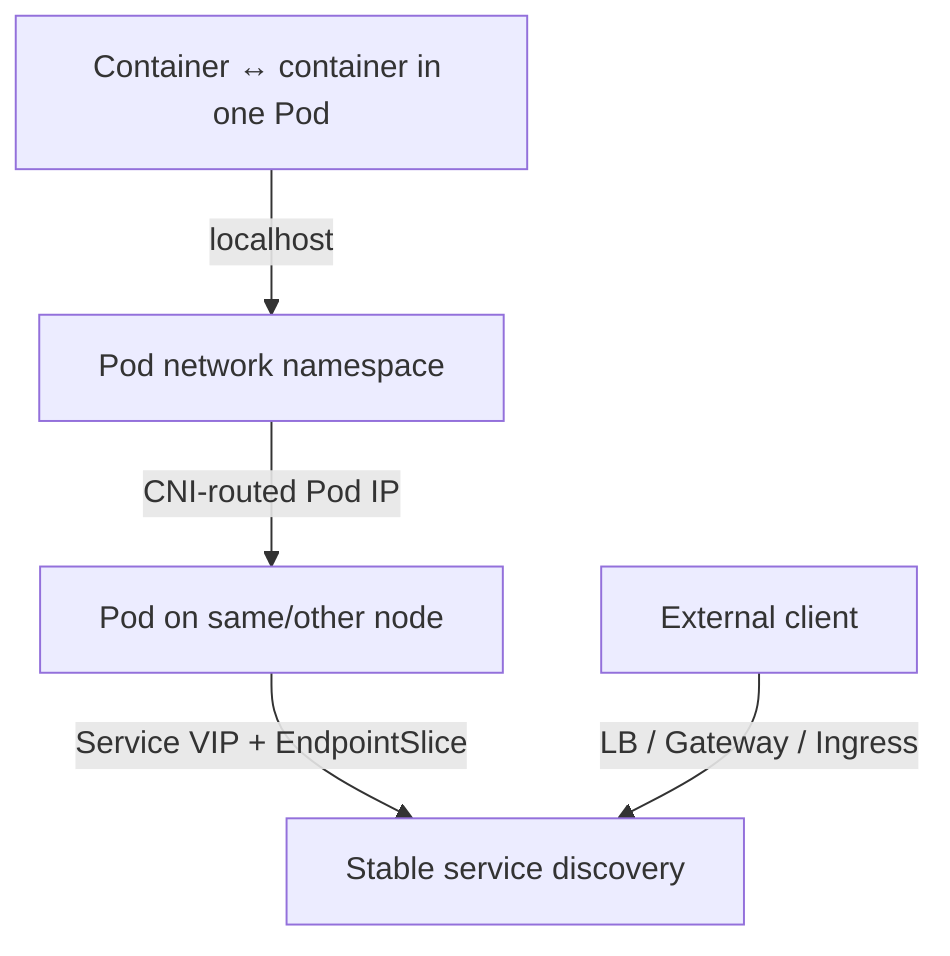
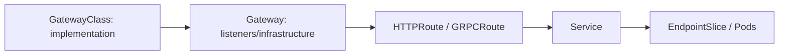

# Kubernetes Networking, Services, DNS, and Gateway API

[← Workloads](02-workloads-scheduling.md) · [Next: Config/storage/security →](04-configuration-storage-security.md)

## Four communication problems



Kubernetes allocates non-overlapping node, Pod, and Service address ranges. The CNI implementation creates Pod connectivity and may enforce NetworkPolicy.

## Pod networking

Containers in one Pod share network namespace and IP; they communicate via localhost but must use different ports. Across Pods, traffic uses Pod IPs. The model expects direct Pod-to-Pod addressing without application-managed port allocation/NAT assumptions, while real implementations may encapsulate, route, NAT egress, or use eBPF internally.

## Service and EndpointSlice

A Service selects or references backend endpoints and provides stable discovery.

| Type | Reachability |
|---|---|
| ClusterIP | virtual IP inside cluster; default |
| NodePort | port on nodes forwarding to the Service |
| LoadBalancer | external load balancer integration plus Service behavior |
| ExternalName | DNS CNAME-style mapping; no proxying |

EndpointSlice objects represent ready/serving/terminating backend addresses at scale. If a Service has no endpoints, check selector/labels, namespace, Pod readiness, ports, and EndpointSlices—not kube-proxy first.

`port` is the Service-facing port; `targetPort` is the backend Pod port; `nodePort` is the optional node exposure.

## kube-proxy and alternatives

kube-proxy watches Services/EndpointSlices and programs node packet handling. On Kubernetes 1.36 Linux modes include iptables, nftables, and deprecated IPVS. nftables is stable and the recommended successor where kernel/CNI compatibility is satisfied. Some CNI/eBPF systems implement Service handling without traditional kube-proxy.

## Cluster DNS

CoreDNS commonly serves names such as:

```text
api.team-a.svc.cluster.local
```

Short-name resolution depends on Pod search domains and namespace. Diagnose DNS with the actual Pod's `/etc/resolv.conf`, CoreDNS health/logs/metrics, Service endpoints, NetworkPolicy, and upstream forwarding. `ndots` and search expansion can create unexpected latency/query volume.

## Ingress and Gateway API

Ingress describes limited HTTP(S) routing and requires an Ingress controller. Gateway API is its successor, with role-oriented resources and richer routing.



Gateway API is not implemented by the API server alone. Install CRDs and a compatible controller. Define listener TLS, hostname/route attachment, cross-namespace permissions, timeouts, retries, and observability explicitly.

## NetworkPolicy

NetworkPolicy controls L3/L4 traffic only when the CNI enforces it. Policies are additive. Once a Pod is isolated for ingress/egress, only allowed traffic for that direction is accepted. Account for DNS, telemetry, control-plane/API, health checks, and required external dependencies.

Begin with inventory/observe, then default-deny per namespace and add precise allows. Test both allowed and denied paths.

## Troubleshooting path

1. Is the application listening on the expected Pod IP/port?
2. Is the Pod ready?
3. Does the Service selector produce EndpointSlices?
4. Can a peer resolve the service name?
5. Can it connect to ClusterIP and directly to endpoint?
6. Does NetworkPolicy/CNI permit it?
7. For external traffic, is the LB/Gateway address, listener, TLS, route, and backend status correct?

Sources: [cluster networking](https://kubernetes.io/docs/concepts/cluster-administration/networking/), [virtual IPs and proxies](https://kubernetes.io/docs/reference/networking/virtual-ips/), [Gateway API](https://kubernetes.io/docs/concepts/services-networking/gateway/), [NetworkPolicy](https://kubernetes.io/docs/concepts/services-networking/network-policies/).

