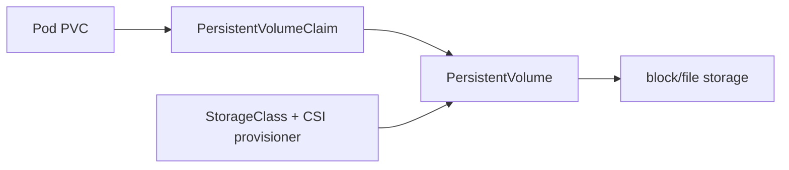
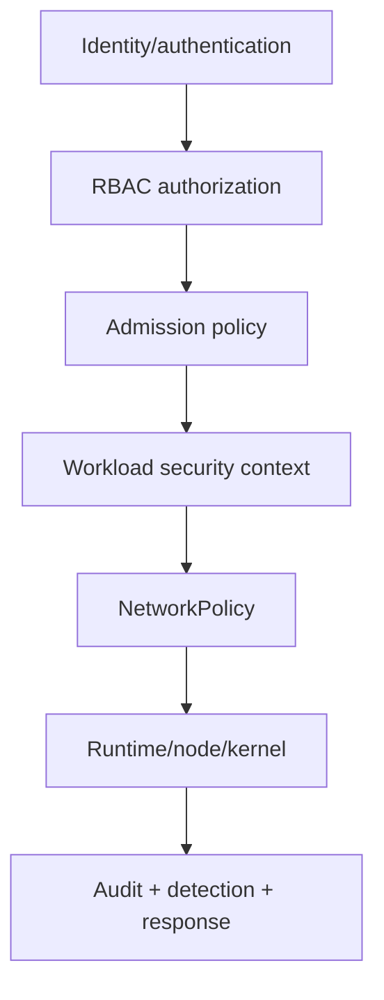

# Kubernetes Configuration, Storage, and Security

[← Networking](03-networking-services-gateway.md) · [Next: Operations →](05-operations-troubleshooting.md)

## Configuration boundaries

- ConfigMap: non-secret configuration.
- Secret: API object for sensitive bytes, but base64 is encoding—not encryption.
- ServiceAccount: workload identity within the cluster.
- external secret/KMS systems: preferred for lifecycle, rotation, audit, and reducing plaintext exposure where appropriate.

Do not put secrets in images, Git, logs, command-line arguments, or broad environment dumps. Enable etcd encryption at rest where required, restrict RBAC, and plan rotation/restart behavior.

## Storage model



- PVC states requested capacity/access/storage class.
- PV represents provisioned storage.
- StorageClass defines dynamic provisioning and policy.
- CSI integrates storage systems.
- StatefulSet volume claim templates can create per-Pod PVCs.

Access modes express requested mount semantics, not universal application-level concurrent-write safety. Reclaim policy determines what happens to the PV after claim deletion. Volume snapshots are not automatically application-consistent backups.

## Security layers



### RBAC

Roles/ClusterRoles define allowed verbs/resources; bindings grant them to users, groups, or ServiceAccounts. Keep permissions namespace-scoped when possible. Avoid wildcards, cluster-admin, and token sharing. Understand escalation paths: creating Pods with powerful service accounts, reading Secrets, modifying webhooks/RBAC, or accessing nodes can imply broader power.

### Pod Security Standards

Kubernetes defines Privileged, Baseline, and Restricted policy levels. Restricted is a strong target for ordinary applications: non-root, no privilege escalation, restricted capabilities, seccomp, and controlled volume types. Enforce through Pod Security Admission and/or policy engines according to requirements.

### Security context example

```yaml
securityContext:
  runAsNonRoot: true
  seccompProfile:
    type: RuntimeDefault
containers:
  - name: app
    image: registry.example.com/app@sha256:REPLACE
    securityContext:
      allowPrivilegeEscalation: false
      readOnlyRootFilesystem: true
      capabilities:
        drop: ["ALL"]
```

Validate image UID and writable paths. `fsGroup` can help volume access but may cause expensive recursive ownership changes and does not solve all NFS behavior.

## Admission and policy

Mutating admission changes requests; validating admission accepts/rejects. Webhooks are availability and trust dependencies: define timeouts, failure policy, namespace/object selectors, version compatibility, TLS, monitoring, and emergency procedures. Prefer built-in policy mechanisms when they meet the requirement.

## Supply chain

- pin image digests;
- generate SBOM/provenance and sign/attest artifacts;
- scan base/runtime packages and dependencies;
- restrict registries and image sources;
- protect build identity and isolate untrusted PR workflows;
- validate deployment policy at admission;
- patch nodes, runtime, control plane, and workloads.

## Backup and recovery

Back up API desired state where it is not already reproducible, etcd, and application data. Test restoration into an isolated environment. Track CSI snapshot portability, encryption keys, cross-region copies, operator-managed resources, and restore ordering.

Sources: [Kubernetes security checklist](https://kubernetes.io/docs/concepts/security/security-checklist/), [Pod Security Standards](https://kubernetes.io/docs/concepts/security/pod-security-standards/), [RBAC good practices](https://kubernetes.io/docs/concepts/security/rbac-good-practices/).

