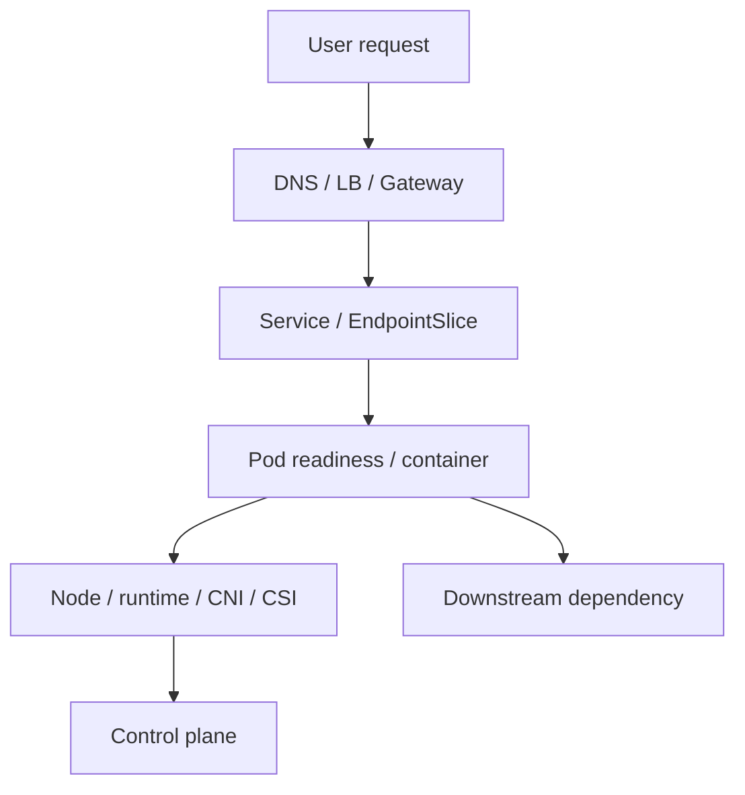

# Kubernetes Operations and Troubleshooting

[← Config/storage/security](04-configuration-storage-security.md) · [IaC →](../05-iac-configuration/01-opentofu-terraform.md)

## Triage from outside inward



## First commands by question

```bash
kubectl get nodes
kubectl get pods -A -o wide
kubectl get events -A --sort-by=.metadata.creationTimestamp
kubectl describe pod <pod> -n <ns>
kubectl logs <pod> -n <ns> --all-containers --since=10m
kubectl logs <pod> -n <ns> -c <container> --previous
kubectl get deploy,rs,sts,ds,job -n <ns>
kubectl rollout status deployment/<name> -n <ns>
kubectl get svc,endpointslice -n <ns>
```

Events are useful but finite/short-lived. Collect them promptly and rely on durable telemetry/audit where required.

## Symptom map

| Symptom | Inspect |
|---|---|
| Pending | scheduler events, requests, taints, affinity, quota, PVC/zone |
| ImagePullBackOff | image name/digest, registry DNS/network, auth, rate limit |
| CrashLoopBackOff | current/previous logs, exit code, command, config, probe, OOM |
| Running but unready | readiness probe, listener, dependency, endpoints |
| OOMKilled | limit, working set, leak, concurrency, node pressure |
| Evicted | node memory/disk/PID pressure, ephemeral storage, QoS |
| rollout stuck | unavailable replicas, probes, quota, PDB, scheduling, image |
| Service unreachable | endpoint readiness, targetPort, DNS, policy, kube-proxy/CNI |
| PVC Pending | StorageClass/provisioner, access mode, zone/capacity, events |

## Debugging tools

- `kubectl exec` uses an existing container; it fails if no shell/tool exists.
- `kubectl debug` can add an ephemeral container or create node/Pod debug contexts where authorized.
- `kubectl auth can-i` tests authorization.
- `kubectl diff` previews server-side differences but is not a full risk plan.
- `kubectl get ... -o yaml` exposes live fields; avoid leaking Secrets.

## Control-plane and node thinking

If many unrelated workloads fail simultaneously, check shared dependencies: API server, etcd, DNS, CNI, CSI, cloud provider, registry, certificate time, node pressure, and recent cluster changes.

On a node inspect kubelet, CRI runtime (`crictl` where configured), kernel logs, filesystem/inodes, cgroups, routes/interfaces, CNI state, and certificates. Do not edit runtime-managed files as a first response.

## Upgrades

1. Inventory versions, deprecated APIs, add-ons, CRDs/webhooks, runtime/CNI/CSI compatibility.
2. Read release notes for every minor step.
3. Back up and test restore.
4. Upgrade control plane and nodes according to supported skew/order.
5. Respect PDBs/capacity while draining.
6. Validate workloads, network, storage, DNS, admission, telemetry, and user journeys.
7. Monitor after change and retain rollback/recovery options.

## Incident record

Keep exact timestamps, object UIDs/namespaces, manifest version, events, logs, node, image digest, recent changes, mitigation, and verification. Convert one-off commands into a runbook only after the mechanism is understood.

## Interview proof

Practice five scenarios aloud: Pending Pod, CrashLoopBackOff, no Service endpoints, PVC Pending, and rollout causing 5xx. Begin with scope/evidence, not random commands.

