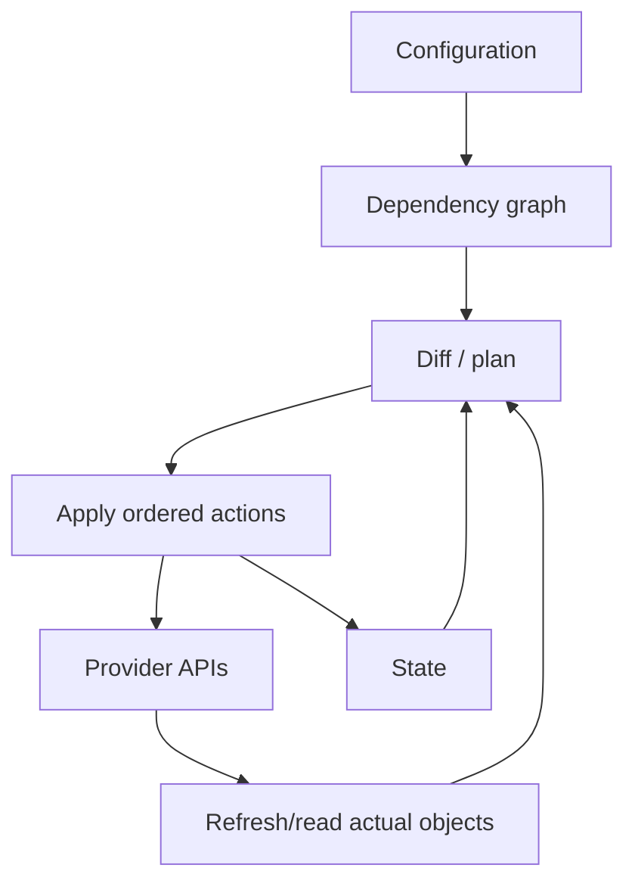

# OpenTofu / Terraform Mental Model

[← Kubernetes operations](../04-kubernetes/05-operations-troubleshooting.md) · [Next: Ansible →](02-ansible.md)

> OpenTofu is used as the open-source-first implementation in this guide. Most core language/workflow concepts are familiar to Terraform users, but features, licenses, providers, and versions must be checked separately.

## Declarative graph plus state



- Configuration declares managed objects and relationships.
- Providers translate resources/data sources into specific APIs.
- State maps configuration addresses to real remote objects and attributes.
- Plan proposes actions from configuration, prior state, and provider reads.
- Apply executes graph actions and writes updated state.

The HCL workflow is portable; resource schemas are provider-specific. One configuration does not automatically work unchanged across AWS, GCP, and Azure.

## Module boundary

All `.tf` files in one directory form one module. The directory called directly is the root module; a referenced directory/registry source is a child module.

A useful module has a focused purpose, typed/validated inputs, intentional outputs, documentation, versioning, examples/tests, and no hidden provider/environment assumptions.

Avoid a giant universal module with dozens of switches. Prefer composition of stable capabilities.

## Workflow

```bash
tofu fmt -check -recursive
tofu init
tofu validate
tofu plan -out=planned.change
tofu show planned.change
tofu apply planned.change
```

In teams, run plans in a trusted pipeline, preserve plan/apply identity and configuration, require review for production, and prevent concurrent applies.

## State is sensitive operational data

State can contain resource IDs, addresses, outputs, and secrets returned by providers. `sensitive = true` mainly hides display; it does not remove the value from state.

Production baseline:

- remote backend with encryption and versioning;
- state locking;
- least-privileged access and audit logs;
- separate state/blast radius for environments/components;
- backups and tested recovery;
- OpenTofu state/plan encryption where appropriate;
- never commit state or plans containing secrets.

OpenTofu's S3 backend supports native S3 locking via `use_lockfile=true` in current documentation. Verify backend version and migration steps before adopting it.

## Dependencies and lifecycle

References create implicit graph edges. Use `depends_on` only for real dependencies the data model cannot express. `for_each` gives stable key-based identities; `count` uses numeric indexes that can shift.

Lifecycle controls (`create_before_destroy`, `prevent_destroy`, `ignore_changes`, replacement triggers) change risk and semantics. `ignore_changes` can hide unmanaged drift, so document why it exists.

## Import, move, and drift

- Import attaches an existing remote object to a configuration address; it does not generate a complete desired configuration by magic.
- `moved` blocks preserve identity when refactoring addresses.
- Removing from state does not necessarily destroy the object, and destroying is not the same as forgetting; current OpenTofu versions include additional lifecycle options—read version docs carefully.
- Scheduled plans can detect drift, but auto-applying every drift correction can be unsafe.

## Provisioners

Provisioners are a last resort because they are hard to model, retry, secure, and make idempotent. Prefer cloud-init/image building, Ansible, Kubernetes controllers, or provider-native resources. If unavoidable, define triggers, timeouts, secret handling, and failure recovery.

## Current facts

At the research snapshot, OpenTofu `1.12.5` was the latest patch. Version `1.12` added features such as dynamic `prevent_destroy` and new lifecycle behavior. Pin supported versions and commit provider lock files.

Sources: [OpenTofu introduction](https://opentofu.org/docs/intro/), [state encryption](https://opentofu.org/docs/language/state/encryption/), [sensitive state](https://opentofu.org/docs/language/state/sensitive-data/), [OpenTofu releases](https://github.com/opentofu/opentofu/releases).
