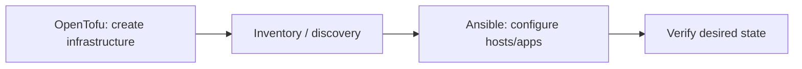

# Ansible: Desired Configuration over Managed Hosts

[← OpenTofu](01-opentofu-terraform.md) · [Next: IaC design →](03-infrastructure-design-testing-security.md)

## Where Ansible fits



OpenTofu commonly owns infrastructure resources; Ansible commonly owns operating-system/application configuration. The boundary can differ, but two tools should not silently fight over the same property.

## Core objects

- inventory: hosts, groups, and variables; static or dynamic;
- playbook: ordered list of plays;
- play: maps target hosts to tasks and execution settings;
- task: invokes a module;
- handler: runs when notified by a changed task, typically restart/reload;
- role: reusable layout of tasks, handlers, templates, defaults, vars, files, and metadata;
- collection: distributed namespace of roles/modules/plugins.

Use fully qualified collection names such as `ansible.builtin.package` to make module selection explicit.

## Idempotency

An idempotent module checks current state and changes only when needed. Prefer modules (`package`, `user`, `template`, `service`) over raw `shell`/`command`. A playbook can still be non-idempotent due to poor conditions, timestamps, commands, or external side effects.

Test a second run: expected result is usually `changed=0`.

## Role layout

```text
roles/example/
├── defaults/main.yml
├── tasks/main.yml
├── handlers/main.yml
├── templates/example.conf.j2
├── files/
├── vars/main.yml
└── meta/main.yml
```

Defaults are meant to be overrideable; role vars have high precedence and should be used sparingly. Understand variable precedence instead of adding more overrides until it works.

## Safe execution

```bash
ansible-inventory -i inventories/dev --graph
ansible-playbook -i inventories/dev site.yml --syntax-check
ansible-playbook -i inventories/dev site.yml --check --diff
ansible-playbook -i inventories/dev site.yml --limit one-host
```

Check mode is valuable but modules may not fully support it and it cannot predict every external effect. Use staging, serial batches, `max_fail_percentage`, explicit health checks, and rollback/forward-fix plans.

## Privilege and secrets

- connect with a named, auditable account;
- use `become` only for tasks requiring it;
- scope sudo permissions where practical;
- encrypt sensitive variables with Ansible Vault or retrieve them from a secret manager;
- do not place vault passwords or decrypted output in Git/logs;
- apply `no_log` narrowly—overuse removes diagnostic evidence and is not a substitute for secret hygiene.

## Good play pattern

```yaml
- name: Configure example API
  hosts: api
  become: true
  serial: 20%
  tasks:
    - name: Render validated configuration
      ansible.builtin.template:
        src: example.conf.j2
        dest: /etc/example/example.conf
        owner: root
        group: example
        mode: "0640"
        validate: /usr/local/bin/example --check-config %s
      notify: Restart example
  handlers:
    - name: Restart example
      ansible.builtin.service:
        name: example
        state: restarted
```

Add pre/post health checks and avoid restarting every host simultaneously.

## Interview proof

Explain inventory, role, handler, idempotency, variable precedence, `become`, Vault, check mode limitations, dynamic inventory, and rolling changes.

Sources: [Ansible playbooks](https://docs.ansible.com/projects/ansible/latest/playbook_guide/playbooks_intro.html) and [inventory guide](https://docs.ansible.com/projects/ansible/latest/inventory_guide/intro_inventory.html).

