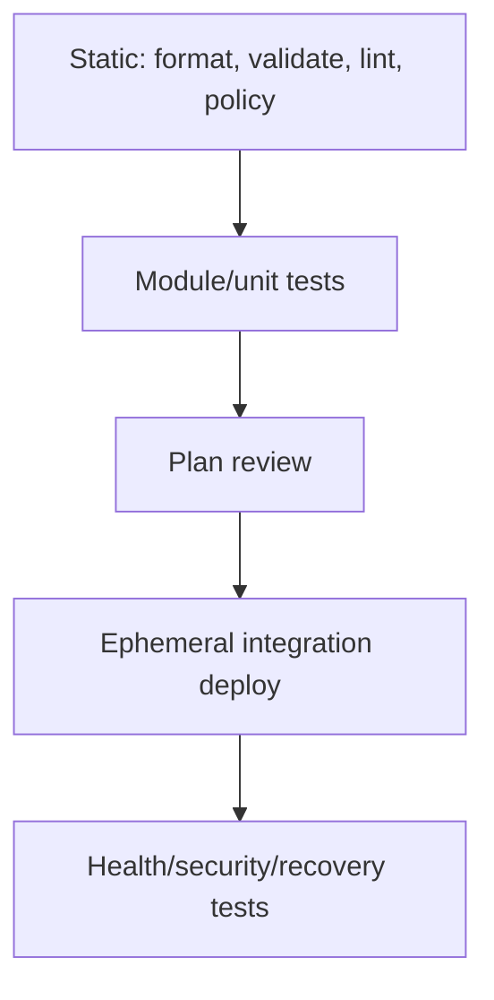

# Infrastructure Design, Testing, and Security

[← Ansible](02-ansible.md) · [CI/CD →](../06-ci-cd/01-delivery-fundamentals.md)

## Separate lifecycle and blast radius

Do not organize infrastructure only by provider resource type. Organize around ownership, change frequency, failure domain, sensitivity, and recovery.

```text
infra/
├── modules/              # reusable, versioned capabilities
├── environments/
│   ├── dev/
│   ├── staging/
│   └── production/
├── policies/
├── tests/
└── docs/
```

Networking foundations, shared identity, application stacks, and data systems often deserve separate state because they have different owners and blast radii.

## Test pyramid for infrastructure



Static checks are cheap but cannot prove cloud behavior. Integration tests cost more but prove real APIs, permissions, routes, and lifecycle. Keep destructive tests isolated in disposable accounts/projects.

## Pipeline controls

- pin tool/provider/module versions and verify checksums/signatures;
- use short-lived federated identity rather than static cloud keys;
- separate plan and apply with artifact/config identity protection;
- ensure the reviewed plan is the applied plan where workflow supports it;
- serialize applies per state;
- require approval for high-risk production/destructive plans;
- log actor, commit, plan, result, and output references without secrets;
- add timeouts and recovery for interrupted runs.

## Policy as code

Policy can check required encryption, public exposure, tags/ownership, approved regions/types, backup, logging, and deletion protection. Distinguish:

- prevention: reject unsafe change;
- detection: report drift/violation;
- remediation: correct safely, often with approval.

Not every policy should be a hard block. Use severity, exceptions with expiry/owner, and evidence that the control works.

## Secrets and identity

Prefer workload identity/OIDC and secret-manager references. State, plan files, CI logs, artifacts, crash dumps, and provider debug logs can all leak secrets. Redact and restrict them as sensitive artifacts.

## Destructive change checklist

1. Resolve exact target and dependency graph.
2. Confirm request scope and owner approval.
3. Verify backup/restore and deletion protection.
4. Review replacement/destroy lines and data implications.
5. Ensure maintenance/traffic plan and rollback/forward-fix.
6. Apply in a bounded environment/window.
7. Verify technical state and user journey.

## Drift

Drift can come from manual change, another controller, provider defaults, external policy, or configuration refactor. Decide ownership before correction. Import/adopt, revert manual change, or intentionally update desired state; do not auto-apply blindly when a second system owns the field.

## Architecture decision records

For important choices record context, decision, alternatives, consequences, security/reliability/cost impact, owner, and revisit trigger. IaC explains **what** exists; an ADR explains **why**.

