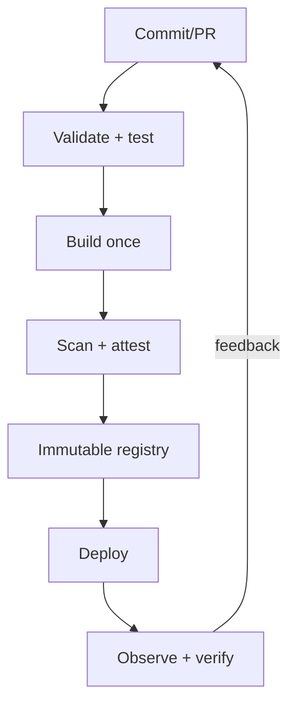

# CI/CD and Delivery Fundamentals

[← Infrastructure testing](../05-iac-configuration/03-infrastructure-design-testing-security.md) · [Next: GitHub/Jenkins →](02-github-actions-and-jenkins.md)

## Terms

- Continuous integration: integrate small changes frequently and automatically build/test them.
- Continuous delivery: every accepted change is kept deployable; production release can be a decision.
- Continuous deployment: accepted changes automatically reach production.

## Pipeline qualities

A good pipeline is fast enough for feedback, deterministic, observable, isolated, least-privileged, retry-aware, and produces immutable artifacts. It distinguishes product failure from transient infrastructure failure.

### Stages

1. validate formatting/schema/licensing/policy;
2. compile/build with locked dependencies;
3. unit tests and static analysis;
4. integration/contract/security tests;
5. package artifact once;
6. generate SBOM/provenance, scan, sign/attest;
7. deploy progressively;
8. verify health and user SLIs;
9. promote the same digest or halt/rollback.

## DORA metrics—current model

As of January 2026, DORA describes five software-delivery performance metrics:

- change lead time;
- deployment frequency;
- failed deployment recovery time;
- change fail rate;
- deployment rework rate.

Use them per service/team over time to improve constraints, not to rank individual engineers. Speed and stability are not inherently opposites; smaller changes and fast feedback help both.

## Artifact versus cache

- Artifact is a result meant to be promoted/retained (image, binary, test report).
- Cache accelerates recomputation and can be discarded.

Treat untrusted cache/artifact inputs as a supply-chain boundary. Never let a forked PR obtain production secrets or write to trusted release locations.

## Environment promotion

Configuration differs by environment; artifact bytes do not. Use environment-specific identity, secrets, approvals, capacity, and policy. Verify migrations are backward/forward compatible during a rolling release.

## Pipeline failure design

- jobs have explicit timeouts;
- retries target known transient operations with exponential backoff/jitter;
- test failures are not blindly retried until green;
- cleanup runs safely even after failure;
- notifications contain actionable context;
- rollback is tested, but roll-forward may be safer after data/schema changes.

## Interview proof

Draw a pipeline for a Rust or web service, explain build-once promotion, short-lived cloud identity, artifact integrity, database migration safety, progressive delivery, and how you measure improvement.

Sources: [DORA delivery metrics](https://dora.dev/guides/dora-metrics/) and [continuous delivery capability](https://dora.dev/capabilities/continuous-delivery/).
