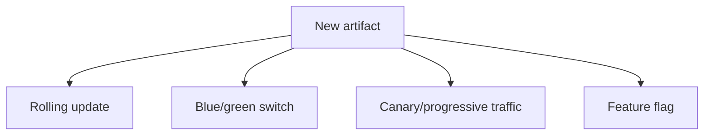
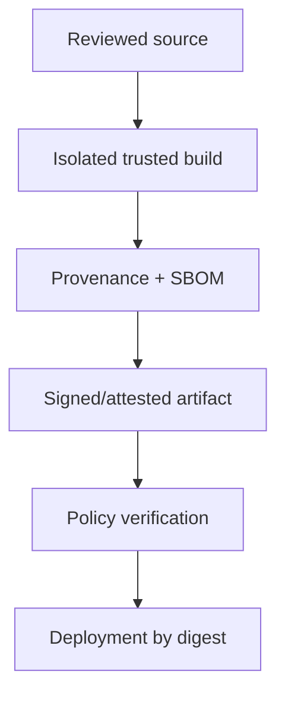

# Testing, Release Strategies, and Software Supply Chain

[← GitHub/Jenkins](02-github-actions-and-jenkins.md) · [Cloud →](../07-cloud/01-cloud-and-aws-foundations.md)

## Test the contract at the cheapest useful level

| Test | Proves | Does not prove alone |
|---|---|---|
| unit | local logic | dependency/network behavior |
| integration | components work together | full user journey at production scale |
| contract | consumer/provider interface compatibility | implementation performance |
| end-to-end | critical journey across system | exhaustive edge cases |
| performance | latency/throughput/capacity behavior | correctness/security by itself |
| resilience | behavior under injected failure | every real failure mode |
| security | selected threat/control behavior | absence of all vulnerabilities |

Use a balanced test portfolio. A flaky test is an operational defect; quarantine only with owner/expiry and fix it.

## Release strategies

| Strategy | Strength | Risk/cost |
|---|---|---|
| rolling | resource efficient | mixed versions; rollback may be gradual |
| blue/green | fast traffic switch | duplicate capacity/data compatibility |
| canary | limits initial blast radius | needs reliable metrics/traffic control |
| feature flags | decouple deploy from release | flag lifecycle and code complexity |

All require schema/API compatibility and a verification signal. A canary without a success criterion is just a small rollout.

## Supply-chain trust path

Controls include dependency pinning, lockfiles, trusted registries, secret isolation, reproducible/hermetic builds where feasible, vulnerability/license scanning, artifact attestations, and admission verification. Scanners produce findings, not proof of safety; triage exploitability, reachability, severity, fixes, and exceptions.

## Database changes

Use expand-and-contract:

1. add backward-compatible schema;
2. deploy code that can use old/new safely;
3. migrate/backfill with bounded load and observability;
4. switch reads/writes;
5. remove old schema only after rollback window.

Rollback application code may fail if schema changes were destructive. Treat data migration as its own controlled operation.

## Production verification

- synthetic critical journey;
- readiness and error/latency SLIs;
- saturation and dependency health;
- logs/traces for new error patterns;
- business correctness when applicable;
- explicit observation window and automatic/manual halt criteria.

## Sources

- [GitHub Actions security and artifact attestations](https://docs.github.com/actions/security-for-github-actions)
- [SLSA specification](https://slsa.dev/spec/)
- [OpenGitOps principles](https://opengitops.dev/)
