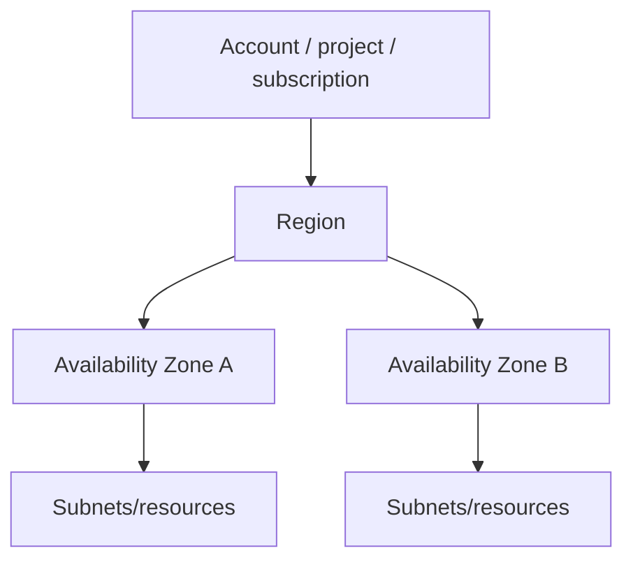

# Cloud and AWS Foundations

[← CI/CD](../06-ci-cd/03-testing-release-supply-chain.md) · [Next: Networking/IAM →](02-aws-networking-and-iam.md)

## Cloud is an operating model, not someone else's VM

Cloud APIs provide on-demand resources, measurable consumption, elasticity, automation, and managed services. The engineering problem becomes designing identity, failure domains, limits, data, observability, and cost—not only creating instances.

## Shared responsibility

The provider secures the underlying cloud; the customer remains responsible for configuration, identities, data, workloads, and controls according to the service model. Managed services reduce some operational work but do not remove architecture, access, backup, or monitoring responsibilities.

## Global hierarchy

AWS accounts are strong isolation/billing/policy boundaries. Regions are geographically separate areas. Availability Zones are independent failure domains connected within a region. A multi-AZ design improves resilience but does not automatically provide multi-region disaster recovery.

## Service-category mental model

| Need | AWS examples | GCP rough mapping |
|---|---|---|
| virtual network | VPC, subnets, routes, SG/NACL | VPC, subnets, routes, firewall rules |
| VM compute | EC2, Auto Scaling | Compute Engine, MIG |
| containers | ECR, ECS/Fargate, EKS | Artifact Registry, Cloud Run/GKE |
| object storage | S3 | Cloud Storage |
| block/file | EBS/EFS | Persistent Disk/Filestore |
| database | RDS/Aurora/DynamoDB | Cloud SQL/Spanner/Firestore |
| load/DNS/CDN | ELB, Route 53, CloudFront | Cloud Load Balancing, Cloud DNS, Cloud CDN |
| identity/secrets | IAM, STS, KMS, Secrets Manager | IAM, STS/WIF, Cloud KMS, Secret Manager |
| observability/audit | CloudWatch, CloudTrail, Config | Cloud Monitoring/Logging, Audit Logs, Asset/Policy |

Mappings are conceptual, not feature equivalence.

## Six Well-Architected pillars

- operational excellence;
- security;
- reliability;
- performance efficiency;
- cost optimization;
- sustainability.

Use them as trade-off questions throughout the lifecycle, not as a one-time compliance checklist.

## Quotas and capacity

Cloud quotas can block an otherwise correct deployment. Check per-region/project/account limits early, request increases before launch, and monitor consumption. Quotas are not guaranteed capacity reservations.

## Control plane versus data plane

Control plane APIs create/configure resources. Data plane serves workload traffic/data. A control-plane incident can prevent new changes while existing data-plane traffic continues, or vice versa. Design access, retries, and observability accordingly.

## Interview proof

Explain region/AZ, account boundaries, shared responsibility, managed versus self-managed trade-offs, quotas, and how you would design for one-AZ failure.

Source: [AWS Well-Architected Framework](https://docs.aws.amazon.com/wellarchitected/latest/framework/welcome.html).

