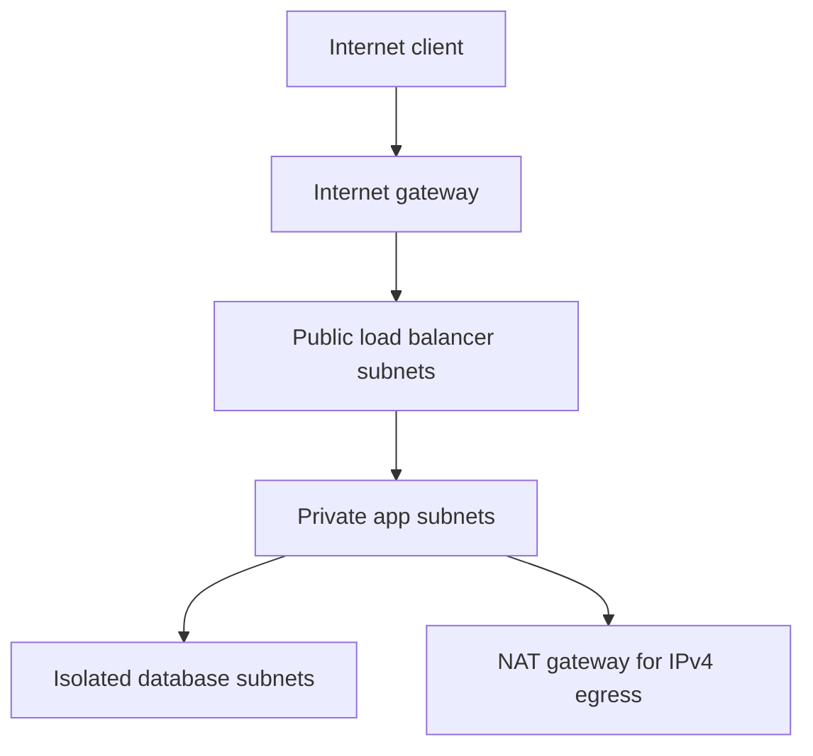
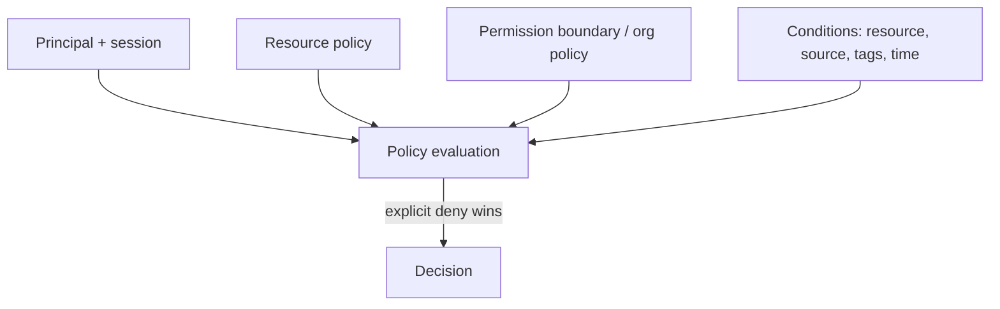

# AWS Networking and IAM

[← Cloud foundations](01-cloud-and-aws-foundations.md) · [Next: Compute/storage/database →](03-aws-compute-containers-storage-database.md)

## VPC request path

A subnet is “public” because its route/exposure design allows public reachability (typically a route to an internet gateway plus public addressing at the resource/LB), not because of its CIDR.

### Routing and controls

- Route tables select next hop by most-specific prefix.
- Security groups are stateful resource-level virtual firewalls.
- Network ACLs are stateless subnet-level filters and require both directions/ephemeral-port reasoning.
- NAT Gateway enables outbound IPv4 translation for private resources; it is not an inbound publication mechanism.
- VPC endpoints/private connectivity can keep supported service traffic off public routes and reduce NAT exposure/cost.
- Transit Gateway/peering/private connectivity solve different topology/scale problems; avoid overlapping CIDRs.

## Load balancers

- ALB: Layer 7 HTTP(S), host/path routing, target groups.
- NLB: Layer 4 TCP/UDP/TLS, high performance and static-address patterns.
- Health checks determine routing eligibility, not complete application correctness.

Design TLS termination, client IP preservation, timeouts, cross-zone behavior, access logs, WAF need, and backend security groups.

## IAM evaluation mental model

Authentication gives a principal/session; authorization evaluates applicable identity/resource policies and guardrails. Default is deny. Explicit deny overrides allow.

### Prefer roles and short-lived sessions

- Humans use federated SSO/MFA and role assumption.
- Workloads use instance/task/Pod/workload identities.
- CI uses OIDC federation to assume a narrowly scoped role.
- Avoid long-lived IAM user access keys; rotate/revoke legacy keys.

Policy design:

- specific actions/resources and conditions;
- separate deployment from runtime permissions;
- use tags/attributes carefully and protect tag mutation;
- log CloudTrail management/data events as required;
- review unused permissions and cross-account trust;
- secure the role trust policy as much as the permission policy.

## Troubleshooting access denied

Identify caller (`sts get-caller-identity`), exact action/resource/region, identity policy, resource policy, role session, permission boundary, organization SCP, KMS key policy/grant, endpoint policy, and condition values. Do not solve by granting `*`.

## Interview proof

Explain security group versus NACL, public versus private subnet, NAT versus IGW, role trust versus permission policy, explicit deny, and OIDC-based CI access.

Sources: [AWS security pillar](https://docs.aws.amazon.com/wellarchitected/latest/security-pillar/welcome.html) and [GitHub OIDC for AWS](https://docs.github.com/actions/deployment/security-hardening-your-deployments/configuring-openid-connect-in-amazon-web-services).
