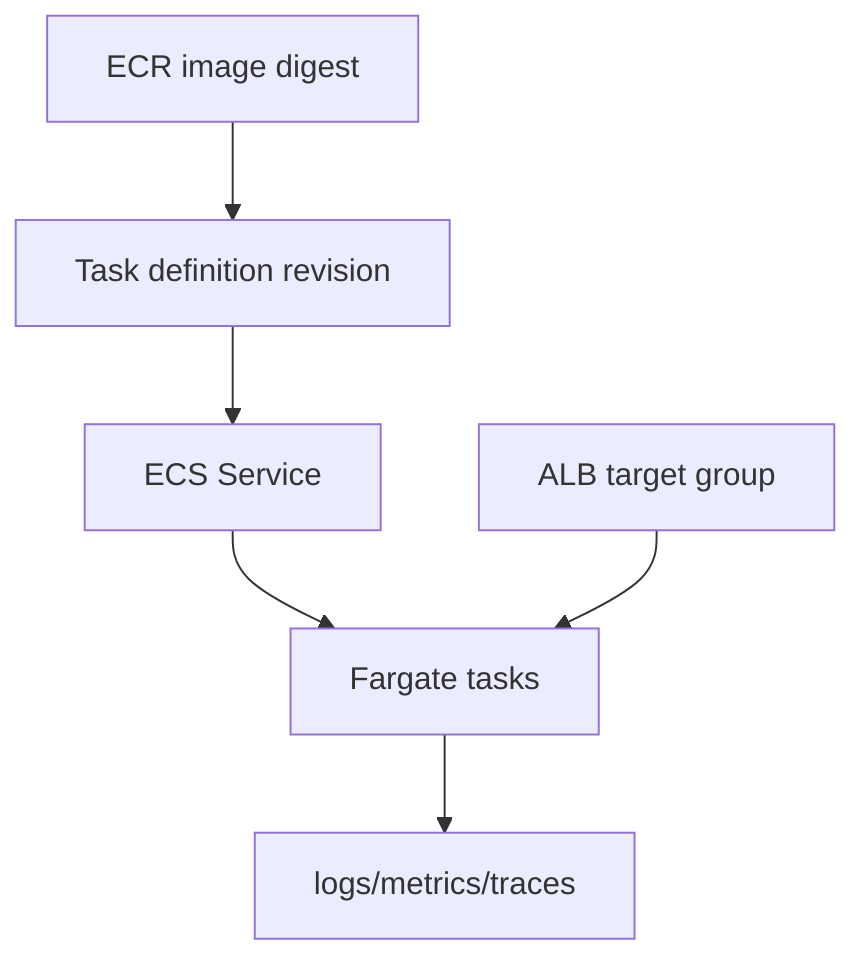

# AWS Compute, Containers, Storage, and Databases

[← Networking/IAM](02-aws-networking-and-iam.md) · [Next: Reliability/cost →](04-reliability-cost-security.md)

## Compute choices

| Option | You manage | Good fit |
|---|---|---|
| EC2 | OS, patches, runtime, scaling design | custom host/runtime/control requirements |
| ECS on EC2 | cluster instances plus workload definitions | AWS-native containers with instance control |
| ECS on Fargate | task definitions/workloads, not instances | simpler serverless container operations |
| EKS | Kubernetes workloads plus many cluster concerns | Kubernetes ecosystem/portability/platform needs |
| Lambda | function code/config and integration | event-driven short execution |

Choose based on constraints and team capability, not trend. More control creates more operational responsibility.

## ECS/Fargate model

- Task definition describes image, CPU/memory, ports, roles, environment/secrets, logging, and health.
- Service maintains desired task count and deployment behavior.
- Task execution role lets the platform pull images/send logs; task role is application runtime permission. Keep them separate.
- Use immutable image digests, private subnets, least-privilege security groups, autoscaling, graceful drain, and deployment alarms.

## S3

S3 is object storage, not a POSIX filesystem.

Concepts: bucket, object key/version, storage class, lifecycle, encryption, access policy, versioning, replication, event, multipart upload.

Security baseline:

- Block Public Access unless intentionally public architecture exists;
- bucket policy/IAM with least privilege and TLS conditions;
- encryption and KMS policy where needed;
- versioning plus deletion/MFA/Object Lock policy for critical data;
- access/audit logging according to requirements;
- lifecycle for cost, with recovery consequences understood.

S3 strong consistency does not make multi-object operations transactional.

## EBS versus EFS versus S3

| Service | Interface | Typical use |
|---|---|---|
| EBS | block device, AZ-scoped attachment patterns | VM filesystems/databases |
| EFS | shared NFS filesystem, regional service | shared POSIX-like files |
| S3 | object API, regional | artifacts, backups, static assets, data lake |

## Databases

Managed RDS reduces host/database operational burden but you still own schema, queries, indexes, connections, credentials, backups/retention, parameter choices, availability design, and recovery testing.

Multi-AZ primarily improves availability/failover; read replicas primarily scale reads and may aid DR patterns, but replication lag/consistency and promotion matter. Do not conflate them.

Watch connections, CPU, memory, storage/IOPS/latency, locks, slow queries, replication lag, backup age, and failover behavior. Connection pooling and bounded retries prevent connection storms.

## Interview proof

Design a small web service using ALB + ECS Fargate + RDS + S3. Explain task/execution roles, private networking, health, secrets, backups, scaling, and cost trade-offs.
