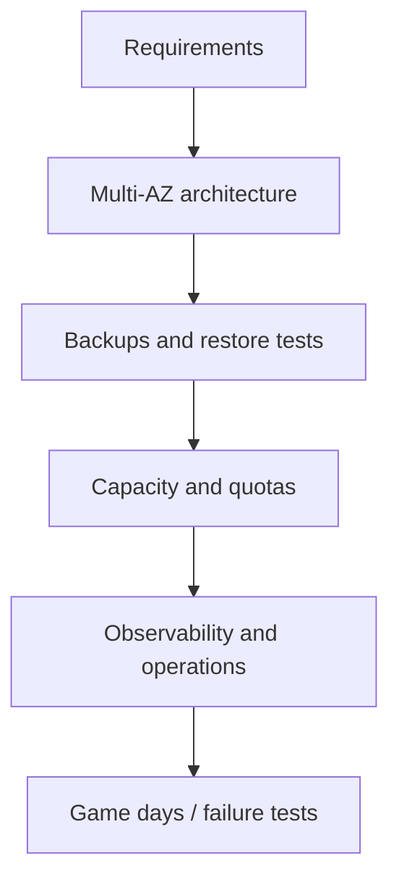

# Cloud Reliability, Cost, and Security

[← AWS services](03-aws-compute-containers-storage-database.md) · [Observability →](../08-observability-sre/01-observability-and-opentelemetry.md)

## Reliability is a requirement-driven trade-off

Start from user journeys, SLO, RPO, RTO, compliance, traffic, and budget. Then choose failure domains and managed services.

Reliability patterns:

- remove single points of failure where SLO requires it;
- stateless horizontal scaling behind health-checked load balancing;
- timeouts, bounded retries with backoff/jitter, circuit breaking, queues/backpressure;
- idempotency keys for retried state changes;
- multi-AZ data/service design and tested failover;
- backups in separate failure/security domain;
- degradation and load shedding before total collapse;
- quota/capacity monitoring.

Retries multiply load. Coordinate budgets across client, proxy, service, and downstream layers.

## Cost model

Cloud cost is quantity × rate across compute time, storage capacity/operations, data transfer, managed-service units, requests, licenses, support, and idle resources.

Optimize continuously:

- tag/label ownership and environment;
- budgets and anomaly alerts;
- right-size from percentiles and seasonality;
- autoscale with min/max and reliability constraints;
- schedule non-production resources;
- choose commitments/spot only with workload tolerance;
- lifecycle/archive/delete data intentionally;
- inspect cross-AZ/region and NAT/egress costs;
- remove orphaned disks, IPs, snapshots, load balancers after ownership validation.

Do not reduce redundancy below the agreed reliability target to make a graph cheaper.

## Security by layers

- organizations/accounts/projects and preventive guardrails;
- federation, MFA, least privilege, short-lived sessions;
- private-by-default networks and explicit exposure;
- encryption in transit/at rest with key lifecycle;
- secret managers and rotation;
- patch/vulnerability/supply-chain management;
- audit logs, detections, incident response;
- backups protected from the same identity/ransomware path;
- data classification and retention.

## Architecture review questions

1. What happens if one task, instance, node, AZ, or region fails?
2. Which component owns state and how is it restored?
3. What is the maximum retry amplification?
4. Which identities can delete production and backups?
5. Which quotas/capacity assumptions can block recovery?
6. What does one user request cost?
7. How will we detect silent corruption or partial failure?

Sources: [AWS reliability pillar](https://docs.aws.amazon.com/wellarchitected/latest/reliability-pillar/welcome.html), [cost optimization pillar](https://docs.aws.amazon.com/wellarchitected/latest/cost-optimization-pillar/welcome.html), [security pillar](https://docs.aws.amazon.com/wellarchitected/latest/security-pillar/welcome.html).

