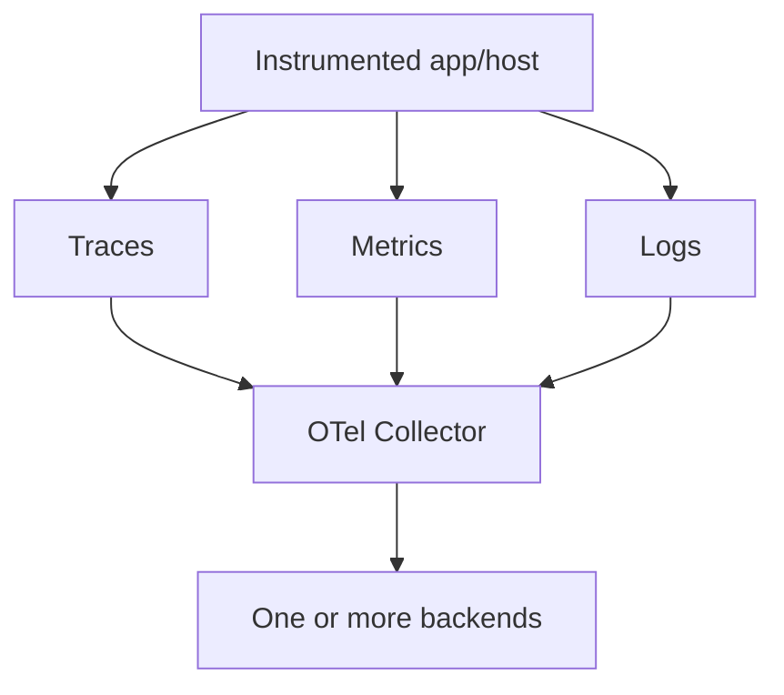
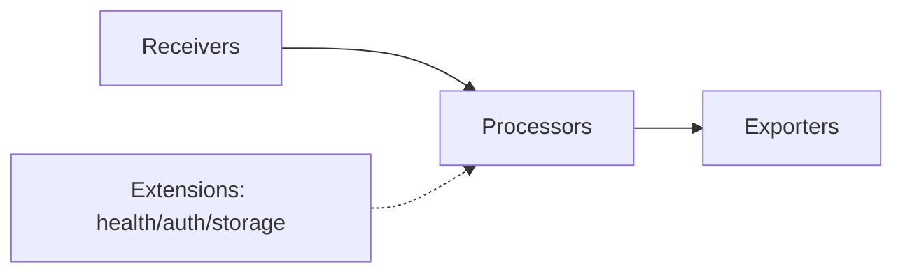

# Observability and OpenTelemetry

[← Cloud](../07-cloud/04-reliability-cost-security.md) · [Next: SLOs →](02-sli-slo-alerting.md)

## Monitoring and observability

Monitoring checks known conditions and service health. Observability is the ability to infer and investigate internal behavior from system outputs. They are complementary; neither is a specific tool.

## Signals are independent but correlated

- Log: timestamped discrete event.
- Metric: numeric measurements over time with attributes/dimensions.
- Trace: causal tree/graph of spans for an operation.

Metrics and traces are not built on logs. They can share resource attributes and trace/span identifiers, making correlation possible.

## OpenTelemetry model

OpenTelemetry provides APIs, SDKs, semantic conventions, instrumentation, OTLP, and a Collector. It is not a storage/query UI by itself.

Collector pipeline:

- receivers ingest OTLP, Prometheus, logs, and other formats;
- processors batch, filter, transform, sample, enrich, limit memory, etc.;
- exporters send to telemetry backends;
- pipelines are signal-specific and must reference enabled components.

Use an agent/DaemonSet collector near workloads when host/local collection is needed and gateway collectors for centralized processing/export. Design buffering/backpressure and failure behavior; telemetry must not crash the application.

## Context and semantic conventions

Resource attributes describe the entity: service name/version, environment/deployment, host, container, Kubernetes metadata, cloud region. Span/log attributes describe an operation/event. Use standard semantic conventions when possible.

Cardinality is the number of unique label/attribute combinations. User IDs, request IDs, raw URLs, timestamps, and unbounded error text can explode metric series and cost. Keep high-cardinality correlation in logs/traces, not metric labels.

## Trace concepts

- trace ID connects the end-to-end operation;
- span ID identifies one operation;
- parent relationship provides causality;
- context propagation carries IDs/baggage across process/network boundaries;
- sampling controls retained traces.

Head sampling decides early and is simple; tail sampling can decide after observing the trace but needs centralized state/resources. Preserve errors/slow or policy-relevant traces without assuming “keep everything.”

## Logs

Use structured events with stable event names and bounded attributes. Normalize timestamps/time zones, severity, service, environment, request/trace ID, outcome, and error type. Redact secrets at source and collector; retention and access are security controls.

JSON Lines is a useful log-file format. Markdown/YAML/XML are poor primary telemetry stores. Metrics belong in a time-series system; traces in a trace backend via OTLP or supported protocols.

## Instrument one request

Capture:

- server request rate, latency histogram, status/error class;
- trace from edge through application/downstream calls;
- structured error log with trace ID;
- dependency connection/queue metrics;
- host/container resource saturation;
- deployment/version attributes.

## Pipeline failure

Monitor the telemetry pipeline itself: received/exported/dropped items, queue length, retry failures, memory limiter, backend latency, cardinality, storage/retention, collector health. A green application with a blind telemetry pipeline is an operational risk.

Sources: [OpenTelemetry signals](https://opentelemetry.io/docs/concepts/signals/), [Collector](https://opentelemetry.io/docs/collector/), [specification overview](https://opentelemetry.io/docs/specs/otel/overview/).
