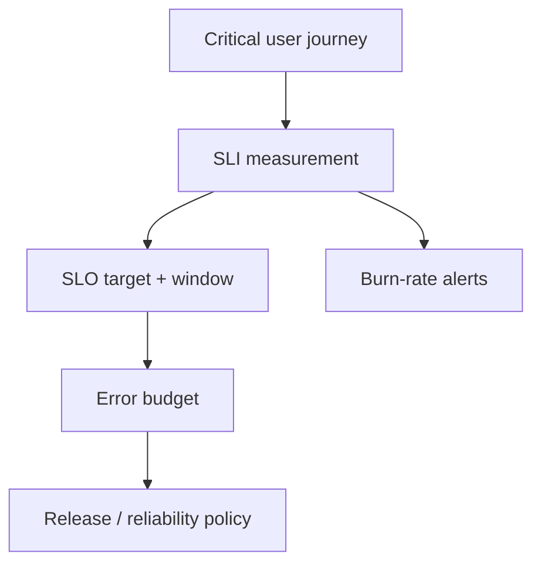

# SLI, SLO, Error Budgets, and Alerting

[← OpenTelemetry](01-observability-and-opentelemetry.md) · [Next: Incidents/capacity →](03-incident-response-toil-capacity.md)

## Start from the user journey

Examples:

- availability SLI = good eligible requests / total eligible requests;
- latency SLI = eligible requests below threshold / total eligible requests;
- freshness SLI = records updated within promised delay / checked records;
- correctness SLI = correct operations / eligible operations.

Define “good,” “valid/eligible,” data source, aggregation, window, exclusions, and ownership. Server uptime is often a poor user SLI.

## SLO and error budget

An SLO is a target for an SLI over a window, such as 99.9% successful eligible requests over 28 days. The error budget is the allowed fraction of bad events: `1 - SLO`.

At 99.9%, the budget is 0.1% of valid events. For time-based intuition over 30 days, 0.1% is about 43.2 minutes, but request-based SLIs should be calculated from requests rather than blindly converted to time.

100% targets are usually harmful unless the measurement/domain truly requires it: they remove room for change and can be impossible to guarantee across dependencies.

## Burn rate

Burn rate compares current error consumption to the rate that would exactly consume the budget over the window.

- burn rate 1: budget consumed exactly across the full window;
- burn rate 10: consuming ten times too fast.

Multi-window, multi-burn-rate alerts combine a short window for urgency with a longer window for confidence. Page on conditions requiring immediate human action; ticket on slower budget risks.

## Alert quality

Every page should be:

- user-impact or imminent-impact relevant;
- actionable by the recipient;
- timely enough to mitigate;
- routed to an owning team;
- enriched with service, scope, dashboard, recent changes, and runbook;
- tested and reviewed for noise.

CPU > 80% is not inherently an incident. Alert on saturation/user impact or a predictive condition with known action. Deduplicate and group by incident, but do not hide distinct failure domains.

## Golden signals, RED, USE

- Golden signals: latency, traffic, errors, saturation.
- RED: rate, errors, duration for request services.
- USE: utilization, saturation, errors for resources.

These organize dashboards/diagnosis. SLOs define reliability from user expectations.

## Error-budget policy

Agree in advance what happens when burn is high or budget is exhausted: halt risky releases, prioritize reliability work, require postmortem/action items, or tighten rollout controls. The exact policy is organizational; Google SRE's examples are guidance, not universal law.

## Dashboard hierarchy

1. service overview: SLO, error-budget burn, traffic, deployments, dependencies;
2. request detail: endpoint/status/latency traces;
3. resources: CPU/memory/I/O/network/queues;
4. telemetry pipeline and data freshness.

## Interview proof

Design an SLO for a login API, calculate its budget, explain why a host CPU alert is insufficient, and describe page versus ticket alerts.

Sources: [Google SRE implementing SLOs](https://sre.google/workbook/implementing-slos/), [alerting on SLOs](https://sre.google/workbook/alerting-on-slos/), [error-budget policy](https://sre.google/workbook/error-budget-policy/).
