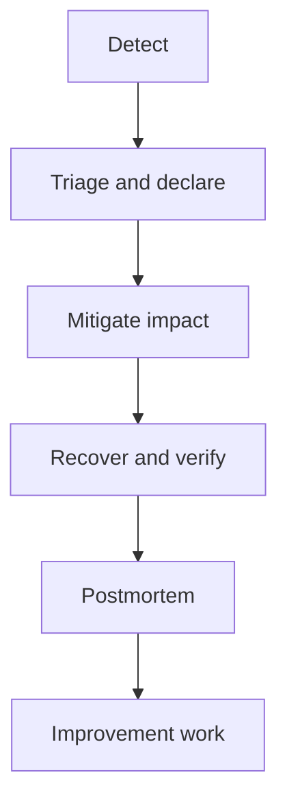

# Incident Response, Toil, Capacity, and Reliability Design

[← SLOs](02-sli-slo-alerting.md) · [Platform engineering →](../09-platform-engineering/01-platform-as-product.md)

## Incident phases



During an incident, optimize for safe service restoration and clear coordination. Root-cause depth can follow after impact is controlled.

## Roles for a significant incident

- Incident commander: owns priorities/coordination, not every technical action.
- Operations/technical lead(s): investigate and execute mitigations.
- Communications lead: stakeholder/customer updates and timeline.
- Scribe: records events, decisions, commands, evidence, and owners.

Small teams may combine roles, but explicitly state who decides and who communicates.

## First response

1. Validate alert and user impact.
2. Declare severity based on impact/scope, not emotion.
3. Freeze or inspect recent changes; do not assume they are causal.
4. Establish one incident channel/timeline.
5. Form ranked hypotheses and assign owners.
6. Apply smallest reversible mitigation: rollback, traffic shift, feature disable, scale boundedly, shed load, fail over.
7. Verify critical user journey and watch for recurrence.

## Communication template

```text
Status: Investigating / Identified / Monitoring / Resolved
Impact: who and what is affected
Start/time zone: exact timestamp
Current action: bounded mitigation/investigation
Next update: timestamp even if no change
```

Avoid speculative root cause in early updates.

## Postmortem

A blameless postmortem does not mean no accountability. It studies why actions made sense given information, tooling, incentives, and safeguards.

Include impact, detection, timeline, root cause mechanism, contributing factors, what worked/did not, and prioritized actions with owner/date. Actions should improve prevention, detection, mitigation, or learning—not merely “be more careful.”

## Toil

Toil is manual, repetitive, automatable, tactical work with little enduring value that scales with service growth. Eliminate it by measuring time/volume, fixing the largest source, automating safely, simplifying the system, improving self-service, or changing ownership/process.

Automation that repeatedly handles a broken design can preserve toil in code. Remove the cause when possible.

## Capacity and overload

- establish demand units and per-instance/service capacity;
- measure latency/error/queue behavior under load;
- keep headroom for bursts, failures, deployments, and autoscaling delay;
- know bottleneck and downstream capacity;
- apply admission control, bounded queues, deadlines/timeouts, backpressure, and load shedding;
- test failover at peak, not only steady state.

Little's Law gives a useful steady-state relation: concurrency ≈ arrival rate × time in system. Rising latency can increase concurrency and resource use even at unchanged traffic.

## Reliability patterns

- redundancy across independent failure domains;
- bulkheads and isolation;
- graceful degradation;
- idempotency and deduplication;
- bounded retries with jitter;
- circuit breakers and dependency budgets;
- cache strategy with staleness/failure semantics;
- disaster recovery with tested restore.

## Interview proof

Tell an incident story as: impact → evidence → ranked hypotheses → mitigation → verification → root cause → prevention. Include what signal shortened detection and what automation reduced recurrence.

Source: [Google SRE Workbook](https://sre.google/workbook/table-of-contents/).
