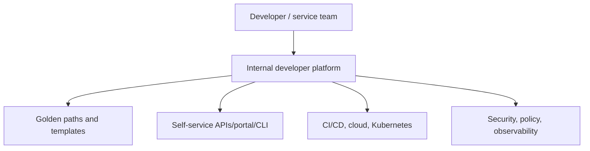

# Platform Engineering: Platform as a Product

[← SRE](../08-observability-sre/03-incident-response-toil-capacity.md) · [Next: GitOps/golden paths →](02-gitops-golden-paths.md)

## What platform engineering solves

As teams grow, every application team independently solving CI, infrastructure, Kubernetes, secrets, observability, policy, and on-call creates high cognitive load and inconsistent risk. A platform team builds reusable capabilities and a supported user experience.

The platform is not merely a portal and not “the DevOps team.” It is a product of capabilities, contracts, documentation, support, and feedback.

## Product principles

- identify user personas and their jobs-to-be-done;
- prioritize common paved roads, not every edge case;
- provide self-service with safe defaults and escape hatches;
- publish ownership, SLOs, support, lifecycle, and deprecation policy;
- measure adoption, task success, lead time, reliability, satisfaction, and support burden;
- gather feedback and iterate;
- treat platform APIs/templates as versioned products.

Golden path does not mean mandatory single path. Make the safe common path easier than bespoke work while preserving justified exceptions.

## Platform capability map

| Capability | Example outcome |
|---|---|
| service creation | repository, owners, baseline docs/tests created |
| build | secure reusable workflow produces signed artifact |
| deploy | environment promotion and policy by default |
| infrastructure | self-service database/bucket/queue with guardrails |
| runtime | namespace/account, identity, network, quotas, backups |
| observability | dashboards, alerts, traces, SLO template |
| operations | runbook, incident ownership, rollback, audit |

## Multi-tenancy and boundaries

Define tenant identity, namespaces/accounts/projects, quotas, network isolation, policy, secret access, noisy-neighbor controls, billing visibility, and break-glass. Kubernetes namespaces alone are not always a sufficiently strong isolation boundary.

## Metrics

Avoid measuring platform success only by number of tools/resources. Better measures include time to first deploy, deployment success, time to provision, adoption/retention, support tickets per onboarded team, reliability of platform APIs, and user satisfaction.

## Anti-patterns

- build a portal before understanding workflows;
- mandate a platform without migration/support;
- expose raw cloud/Kubernetes complexity as “self-service”;
- optimize for the platform team's preferences rather than user outcomes;
- create a ticket queue with a nicer UI;
- hide ownership when generated services fail;
- fork every tool instead of maintaining thin integrations.

## Interview proof

Design a “create a new HTTP service” golden path. State personas, API/inputs, generated resources, security defaults, SLO, ownership, escape hatch, lifecycle, and success metrics.

Sources: [CNCF Platforms white paper](https://tag-app-delivery.cncf.io/whitepapers/platforms/) and [platform engineering maturity model](https://tag-app-delivery.cncf.io/whitepapers/platform-eng-maturity-model/).

