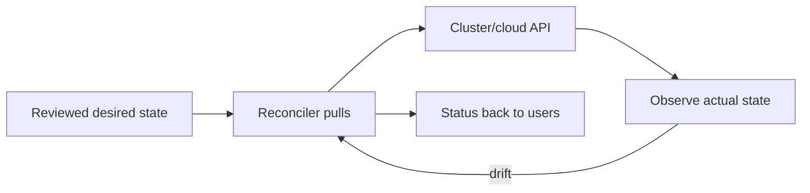

# GitOps, Golden Paths, and Developer Experience

[← Platform as product](01-platform-as-product.md) · [Data systems →](../10-data-systems/01-dbms-and-sql.md)

## GitOps principles

OpenGitOps defines desired state as:

1. declarative;
2. versioned and immutable;
3. pulled automatically;
4. continuously reconciled.

Storing YAML in Git is not sufficient. A GitOps agent must reconcile actual state and report divergence. A mutable image tag such as `latest` weakens versioned/immutable desired state.

## CI versus GitOps CD

CI builds/tests/signs an artifact and updates a desired-state reference through review. The in-environment reconciler pulls and applies it. This reduces direct CI credentials to the runtime and makes drift visible.

Define emergency procedures: if a human hotfixes the cluster, reconciliation may revert it. Record the change in desired state or suspend reconciliation through an audited bounded process.

## Repository strategies

- monorepo: simpler atomic visibility, larger permissions/scale concerns;
- repo per service/environment/team: stronger ownership boundaries, coordination/reuse complexity;
- application source and environment config may be separate to protect production approvals.

Choose based on ownership, authorization, change coupling, and scale—not ideology.

## Golden-path contract

A template should produce maintainable ownership, not a one-time scaffold that immediately drifts.

Include:

- service metadata and owners;
- build/test/dependency policy;
- image/release workflow;
- deployment/resource defaults;
- identity/secrets and network policy;
- telemetry/SLO/runbook;
- documentation and local development;
- upgrade mechanism for template changes.

## Developer experience

Good DX reduces time and cognitive load without hiding necessary operational reality. Provide clear errors, previews, progress/status, documentation near failure, safe defaults, local/test environments, and consistent interfaces (API/CLI/portal).

Measure task success and time-on-task. A portal click that triggers a three-day ticket is not self-service.

## Policy and exceptions

Enforce high-confidence safety controls early; surface advisory improvements without blocking. Exceptions need owner, reason, compensating control, scope, and expiry. Make policy errors explain what failed and how to fix it.

## Interview proof

Explain the four GitOps principles, why pull-based reconciliation changes credential boundaries, how you handle emergency changes, and how a golden path differs from a static template.

Sources: [OpenGitOps principles](https://opengitops.dev/) and [DORA capability catalog](https://dora.dev/capabilities/).

