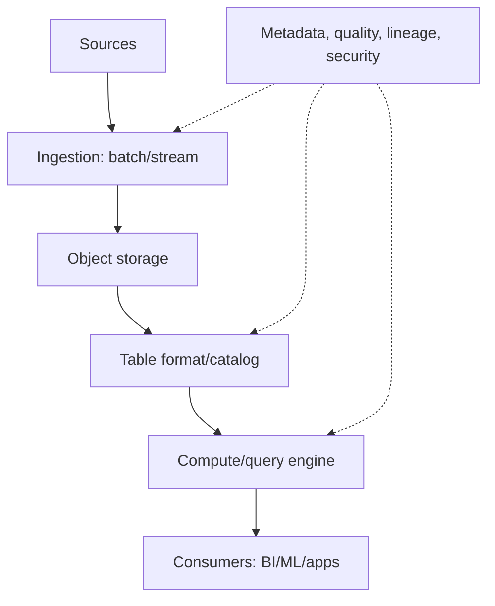

# Data Pipelines and Lakehouse Mental Model

[← DBMS](01-dbms-and-sql.md) · [Next: Runbook lessons →](03-data-platform-runbook-lessons.md)

## The data path

Separate storage, metadata/catalog, compute, and orchestration in your mental model. A failure in one does not mean “the data lake is down.”

## Core concepts

- batch: bounded dataset processed periodically;
- stream: unbounded event flow processed continuously or in windows;
- ETL: transform before loading target; ELT: load then transform in target engine;
- object store: durable objects, not a filesystem;
- file format: CSV/JSON for interchange; Parquet/ORC for columnar analytics;
- table format: metadata/transaction layer such as Iceberg/Delta/Hudi concepts;
- catalog/metastore: schemas, partitions, locations, and table metadata;
- query engine: Trino/Spark/etc. reads through connectors/catalogs;
- orchestrator: schedules dependencies/retries (for example Airflow), not the compute itself.

## Correctness properties

Decide delivery semantics rather than claiming “exactly once” casually.

- at-most-once can lose data but avoids duplicates;
- at-least-once retries and needs idempotency/deduplication;
- effectively/exactly-once requires carefully scoped transactional/idempotent boundaries.

Track event time versus processing time, ordering, watermarks/late data, schema evolution, replay, deduplication keys, checkpoints, and backfills.

## Data quality and governance

Define ownership, schema contracts, freshness, completeness, validity, uniqueness, lineage, classification, access, retention, and deletion. Encrypt, authenticate, authorize at catalog/storage/engine layers, and audit sensitive queries.

## Your data-platform stack, generalized

Your notes combine PostgreSQL metastore state, Hive-style metadata, S3-compatible object storage, Trino query, Spark compute, Airflow orchestration, OpenSearch/Logstash ingestion/search, Keycloak identity, Ranger policy, NFS, and Kubernetes. This is valuable project depth but not a universal DevOps prerequisite.

Treat each component by contract:

| Component role | State/critical dependency |
|---|---|
| identity provider | users/clients/keys; TLS/DNS/time |
| metastore DB | schemas/transactions/backups |
| object storage | durable data/buckets/policies |
| query engine | catalogs, workers, memory, source reachability |
| orchestrator | DAG definitions, scheduler metadata, worker capacity |
| policy engine | identities, policies, plugin compatibility |
| shared filesystem | UID/GID, exports, capacity, availability |

## Interview proof

Draw the path from CSV/event to dashboard, name state owners, explain batch versus stream, Parquet versus CSV, catalog versus object store, and how replay avoids duplicates.
