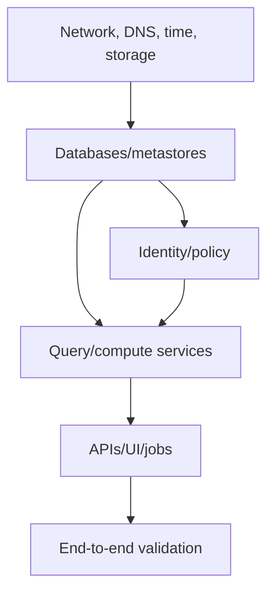

# Data-Platform Runbook Lessons from Your Notes

[← Data pipelines](02-data-pipelines-and-lakehouse.md) · [Rust/automation →](../11-rust-automation-ai/01-rust-for-operations.md)

## Preserve incidents as mechanisms

Your notes include rich deployment histories for Postgres, Hive/Trino, Querybook, NFS, Spark, Airflow, Keycloak, Ranger, MinIO/object storage, TLS/Ingress, and Kubernetes. The reusable lessons are below.

## Dependency-first startup

“Container is running” is not readiness. Validate ports, authentication, schema initialization, storage write/read, query execution, and user journey.

## Recurring failure classes

### Numeric ownership on shared storage

Container users, NFS owners, StatefulSet security context, and database-required permissions must align. Verify numeric IDs and root-squash/SELinux behavior. Document who creates/chowns directories and make bootstrap idempotent.

### Schema initialization and version compatibility

A running database may lack expected tables because migrations/schematool did not run, ran against the wrong database/schema, or used a different application version. Check connection target, migration history, and supported upgrade sequence before querying a guessed table.

### TLS and identity coupling

Keycloak/OIDC clients, redirect URIs, hostnames, certificates, Ingress/Gateway TLS, proxy headers, and clocks form one contract. An IP-based self-signed certificate may make a lab work but is fragile for production identity flows.

### NFS as hidden single point of failure

Many shared volumes can make one NFS server a platform-wide failure and performance bottleneck. Monitor exports, capacity/inodes, latency, client mounts, locks, UID/GID, backups, and server recovery. Decide where block/object storage is a better fit.

### Dependency/version pinning

Java, Python, Node, native libraries, JDBC drivers, container images, Helm charts, and CRDs must be versioned as a compatibility matrix. “Install latest” makes reproducibility poor.

### Private image transfer

Manually copying image tar files to nodes can unblock offline labs but creates distribution, integrity, garbage-collection, and update problems. Prefer a controlled registry with digests/signatures, or document the offline artifact manifest and verification.

## Phase-based deployment

For complex stacks use checkpoints:

1. host/cluster prerequisites;
2. network, DNS, certificates, storage;
3. stateful foundations;
4. identity/policy;
5. compute/query/ingestion;
6. user interfaces;
7. observability, backup, restore, and failure tests.

Each phase must have acceptance checks and safe rerun behavior.

## Runbook quality gate

A runbook should include goal, scope, prerequisites, variables/placeholders, exact expected output, failure branches, rollback, verification, security warnings, and last tested versions/date. Remove real passwords, tokens, private keys, host IPs, and personal contacts.

