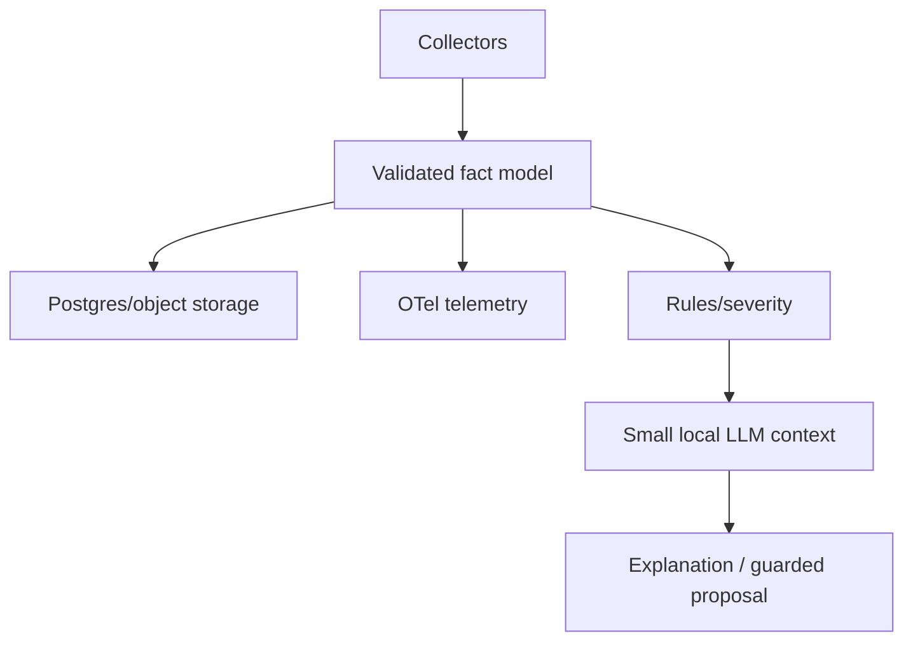

# Rust for Operations Automation

[← Data runbooks](../10-data-systems/03-data-platform-runbook-lessons.md) · [Next: AI agent →](02-operational-ai-agent.md)

## Why Rust can fit operations tools

Rust provides a single native binary, explicit error handling, memory safety without a garbage collector, concurrency, strong types, and good CLI/server libraries. Trade-offs are compile time, learning curve, ecosystem choices, and more design work than a small shell script.

## Useful crate map

| Need | Typical ecosystem choices |
|---|---|
| CLI | `clap` |
| async runtime | `tokio` |
| HTTP API | `axum`, `tower` |
| HTTP client | `reqwest` |
| serialization | `serde`, `serde_json`, YAML/TOML crates |
| errors | `thiserror` for typed errors, `anyhow` for application context |
| logging/tracing | `tracing`, OpenTelemetry integration |
| database | `sqlx` or another driver |
| metrics | OpenTelemetry/Prometheus ecosystem |

Choose based on maintenance and requirements; crate versions change.

## Reliable CLI structure

```text
parse inputs
→ validate scope/permissions/config
→ build a plan
→ optionally show dry run
→ execute bounded actions
→ verify outcomes
→ emit structured evidence
→ return meaningful exit code
```

Use typed configuration, redacted secret wrappers, cancellation/timeouts, bounded concurrency, retries only for retryable errors, and deterministic output modes (`human` and `json`).

## Async mental model

Async helps when many tasks spend time waiting on sockets/timers. It does not make CPU-heavy work faster. Never hold blocking operations or locks across async waits without design. Use bounded channels/semaphores for backpressure and cancellation tokens/graceful shutdown.

## Error design

Add context at boundaries: operation, target, source error, and retryability. Do not flatten every error into a string too early. User output should be concise; debug logs can contain structured chains without secrets.

## OSAI-style architecture



Keep collection and deterministic facts independent from the model. The model explains or proposes; a policy/approval executor decides actions.

## Logs, metrics, traces, state

- JSONL for structured event logs;
- metrics as numeric instruments exported through OTel;
- traces around scan/API/storage/model/executor operations;
- JSON/YAML/TOML for config/state only where appropriate;
- Markdown for generated human reports;
- Postgres/object storage for durable queryable state/artifacts.

## Interview proof

Explain ownership/borrowing at a high level, `Result`/error propagation, sync versus async, bounded concurrency, graceful shutdown, structured telemetry, and why a single binary does not include external databases or kernels.
