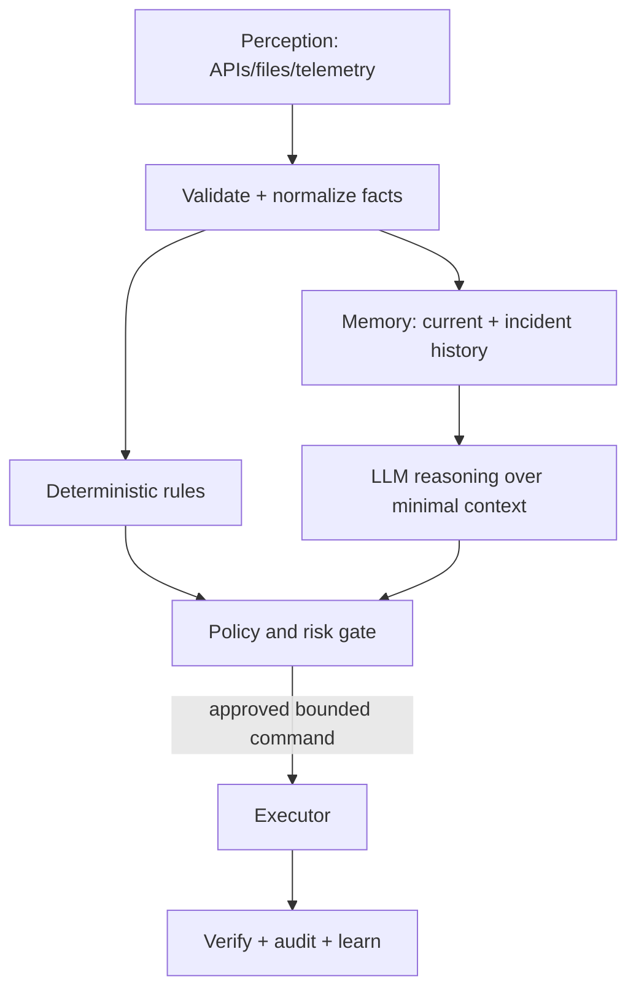

# Designing a Guarded Operational AI Agent

[← Rust for operations](01-rust-for-operations.md) · [Projects →](../12-projects/01-ecs-fargate-project.md)

## Separate perception, facts, reasoning, and action

An LLM is probabilistic text reasoning, not a source of truth. The agent should cite collected evidence and expose uncertainty.

## Data model

Store:

- host/service inventory and relationships;
- observations with timestamp/source/freshness;
- incidents with symptoms, evidence, cause, fixes, verification;
- proposed actions and policy decisions;
- audit outcomes and feedback;
- telemetry identifiers for correlation.

Separate immutable event history from current materialized state. Define retention and “forget” semantics, especially for personal/sensitive data.

## Guarded action levels

| Level | Example | Default control |
|---|---|---|
| read-only | status, logs, metrics, API GET | allow within scoped inventory |
| reversible low-risk | restart one stateless test service | policy + explicit target + verify |
| production mutation | scale/deploy/config change | plan + human approval + rollback |
| destructive/security-sensitive | delete data, rotate identity, firewall | multi-party workflow or deny |

Commands should be structured operations with validated arguments, not free-form shell produced by a model.

## Prompt-injection and tool risk

Logs, web pages, tickets, and repository content are untrusted data and may contain instructions. Never let retrieved text redefine system policy or silently authorize tools. Enforce tool allowlists, parameter schemas, resource scopes, identity, output limits, timeouts, and audit outside the model.

## Observability

Trace perception → retrieval → model → policy → action → verification. Measure model latency/token use, retrieval quality, tool errors, denial/approval, action success, false positives, and user correction. Redact prompts/responses according to data policy.

## Small local model strategy

A CPU-friendly local model can explain a compact fact pack. Keep context small and structured, retrieve only relevant incident history, and use deterministic severity/routing. Degrade gracefully when the model is unavailable: collection, rules, storage, alerts, and dashboard should continue.

## Evaluation

Build a fixed scenario set: known healthy, known incident, ambiguous evidence, stale data, injected malicious log, unauthorized target, tool timeout, and model unavailable. Score factual grounding, correct abstention, policy compliance, and verified resolution—not eloquence.

