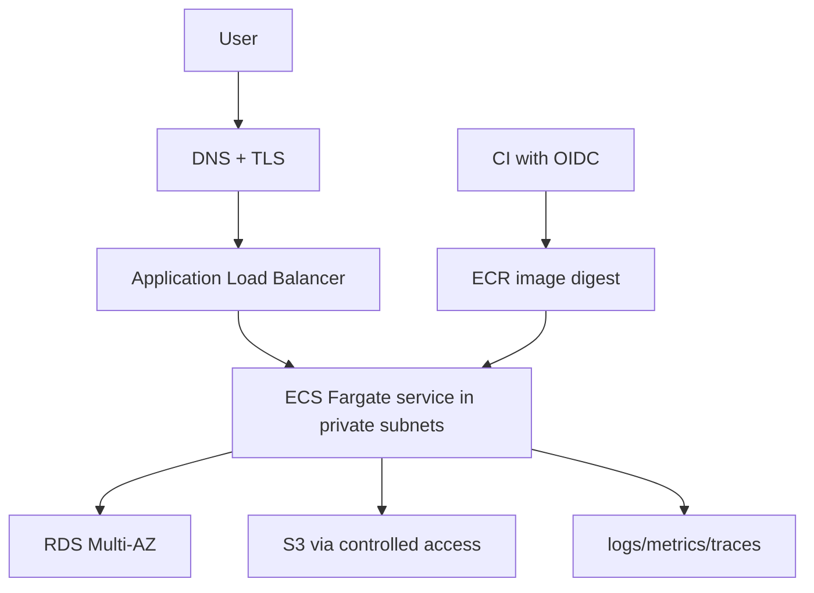

# Portfolio Project: AWS ECS Fargate Delivery

[← AI agent](../11-rust-automation-ai/02-operational-ai-agent.md) · [Next: On-prem platform →](02-onprem-data-platform.md)

## Architecture

## What to demonstrate

- OpenTofu modules/state/plan review;
- VPC across two AZs, public ALB and private tasks/database;
- SG references rather than broad CIDRs;
- ECR immutable/digest deployment and scan/attestation;
- separate ECS task execution role and application task role;
- Secrets Manager/Parameter Store references, no secrets in state where avoidable;
- health checks, graceful shutdown, autoscaling, deployment circuit breaker/alarms;
- RDS backup/PITR and restore test;
- OTel/logging and SLO dashboard;
- budget/anomaly alert and cost explanation;
- CI OIDC and environment approval.

## Delivery flow

1. PR runs format, tests, lint, IaC validation/security policy.
2. Main build creates one image, SBOM/provenance, scans and pushes digest.
3. Environment repo/config updates digest through review.
4. OpenTofu/ECS deploys progressively.
5. Synthetic test and SLI gates determine promotion/rollback.

## Failure demonstrations

Create safe lab scenarios: bad readiness path, insufficient DB SG, revoked task permission, task OOM, one-AZ target loss, expired/misconfigured certificate in staging. For each show symptom, evidence, root cause, fix, verification, prevention.

## Interview story

Explain why Fargate was selected over EKS, which responsibilities remain, how identity avoids static keys, where state lives, how one-AZ failure behaves, and what dominates monthly cost.

