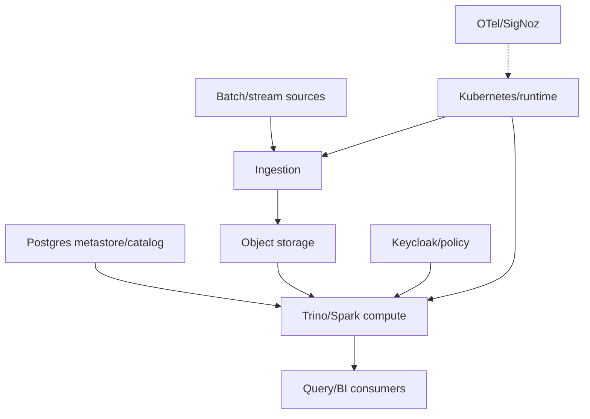

# Portfolio Project: On-Prem Data Platform

[← ECS project](01-ecs-fargate-project.md) · [Next: Evidence template →](03-project-evidence-template.md)

## Architecture boundary

## Build in phases

| Phase | Acceptance check |
|---|---|
| host/cluster | nodes Ready; time/DNS/runtime/storage healthy |
| persistent foundations | object put/get; Postgres transaction/backup |
| metadata | schema initialized; catalog query succeeds |
| identity/policy | test user/token and allowed/denied query |
| compute | worker registered; bounded sample query |
| ingestion | sample dataset idempotently loaded and validated |
| observability | trace/log/metric visible; actionable alert tested |
| recovery | restore metastore/data/config in isolated test |

## Design decisions to explain

- why Kubernetes is or is not needed for each stateful component;
- NFS versus block/object storage and failure-domain implications;
- identity flow and TLS/DNS dependencies;
- catalog/table format and schema evolution;
- version compatibility matrix for Java/Python/charts/plugins;
- air-gapped image/artifact verification;
- node/resource scheduling and noisy-neighbor control;
- backup and restore order.

## Improve your original runbooks

Replace machine-specific IPs and copied terminal streams with variables and acceptance checks. Use one configuration source, version pins, checksums, idempotent phase markers, `--check`/plan behavior, timeouts, rollback, and a final evidence report.

## Strong interview angle

This project proves depth when framed around integration failures and decisions, not a list of installed tools. Tell one UID/NFS incident, one schema/migration incident, one TLS/identity incident, and one recovery test.

