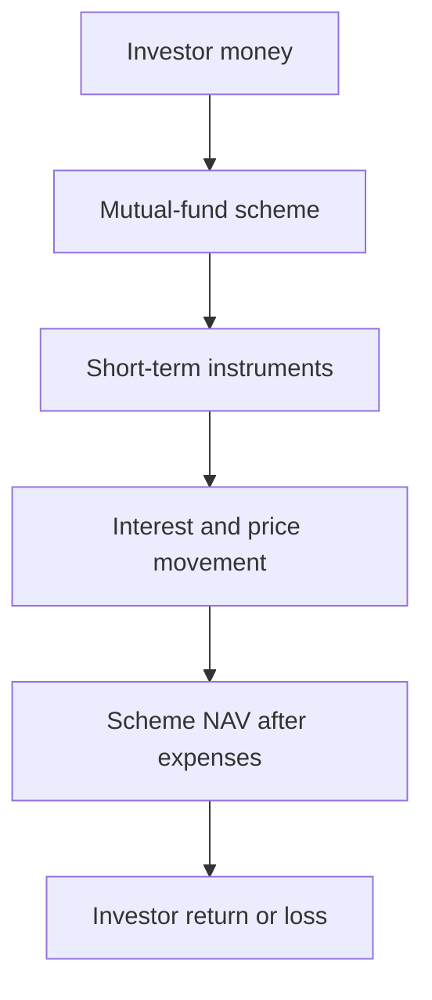
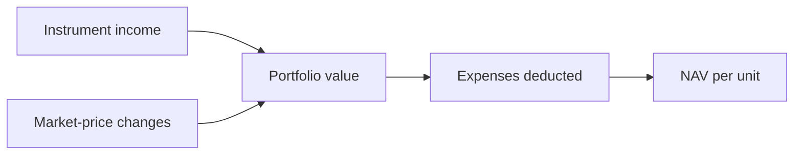
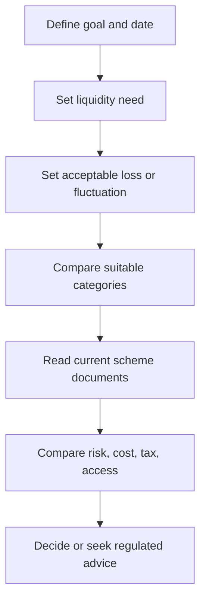

# Personal Finance: Overnight and Money-Market Funds

[← Home](../README.md) · [Contents](../TABLE-OF-CONTENTS.md)

> This chapter preserves the finance concepts found in the source notes. It is educational, not personal investment or tax advice. Product features, tax rules, expenses, risk labels, and cut-off rules change; verify the current scheme documents and official guidance before acting.

## First mental model

Money markets are where governments, banks, and companies borrow or lend for short periods. Common instruments include Treasury bills, repos, commercial paper, and certificates of deposit. A debt mutual fund owns a portfolio of instruments; you own units whose net asset value, or **NAV**, changes with that portfolio.

The key correction is simple: a debt fund is **not** a bank deposit and is not guaranteed merely because its portfolio is short term. Shorter maturity generally reduces interest-rate sensitivity, but credit, liquidity, concentration, operational, reinvestment, and market risks remain.

## Overnight fund versus money-market fund

| Question | Overnight fund | Money-market fund |
|---|---|---|
| What it mainly holds | Securities maturing in about one business day | A wider set of short-term money-market instruments |
| Typical reason to examine it | Very short parking period and liquidity | Short-term allocation with scope for somewhat more yield and risk |
| Interest-rate sensitivity | Usually very low | Usually higher than an overnight fund, depending on portfolio maturity |
| Credit and liquidity exposure | Low does not mean zero | Depends strongly on issuers, instruments, and concentration |
| Return certainty | Not guaranteed | Not guaranteed |
| What decides suitability | Time horizon, access needs, costs, risk, and alternatives | The same, plus duration and portfolio credit quality |

Do not choose only by the last reported return. A recent yield can change quickly and does not promise the same future result.

## How NAV and return connect

A simplified view is:

`investor return ≈ interest earned ± price change − expenses − applicable taxes`

The published NAV already reflects scheme expenses. Your realised outcome can also be affected by when the purchase or redemption receives an applicable NAV, any exit load, and tax treatment.

## Read these documents before comparing products

1. **Scheme Information Document (SID):** objective, permitted instruments, benchmark, risks, fees, redemption terms, and investment restrictions.
2. **Key Information Memorandum (KIM):** compact summary of important scheme facts.
3. **Latest factsheet and portfolio:** maturity profile, issuer mix, concentration, credit quality, and recent changes.
4. **Riskometer:** the regulator-defined risk label for the scheme and benchmark.
5. **Total Expense Ratio (TER):** recurring expenses as a percentage of assets.
6. **Exit load and cut-off rules:** possible redemption charge and the rules that determine applicable NAV.
7. **Current tax rules:** check an official source or qualified professional for your situation.

## Evaluation checklist

Use this framework for any product mentioned in the original notes, including a product from JioBlackRock or another asset manager. Treat a brand name as a prompt to investigate, not as a recommendation.

- What exact problem is this money solving: emergency access, a known near-term payment, or investment?
- When will the money be needed, and can the redemption timeline meet that date?
- Is capital fluctuation acceptable, even if small?
- What are the current SID, KIM, factsheet, TER, exit load, and Riskometer?
- Which instruments and issuers are in the latest portfolio?
- Is there concentration in one issuer, group, instrument type, or maturity bucket?
- How does the after-cost, after-tax outcome compare with suitable bank or government-backed alternatives?
- Does the comparison use the same period and the same level of liquidity and risk?
- Are direct and regular plans being compared correctly? A regular plan pays distributor expenses; a direct plan does not include that distribution channel.
- Has the decision been based on one trailing return, a promotional yield, or an assumption that low risk means no risk?

## Red flags in reasoning

- “The NAV cannot fall because maturity is short.”
- “The latest annualised return is what I will earn.”
- “A higher credit rating removes all default or liquidity risk.”
- “The largest fund or best-known brand must be safest.”
- “Growth and IDCW options change the underlying portfolio risk.” They mainly change how gains or distributions are represented; current tax and cash-flow effects still need verification.
- “Instant redemption is universal.” Availability, limits, settlement, and cut-off treatment depend on current scheme and platform rules.

## A repeatable decision flow

## Retention prompts

- Explain why an overnight fund can still have risk.
- Name four money-market instruments and who typically issues them.
- Explain NAV, TER, duration risk, credit risk, and liquidity risk without using marketing language.
- Given two factsheets, identify the important differences before looking at returns.

## Official starting points

- [RBI primer on government securities and Treasury bills](https://www.rbi.org.in/commonman/english/scripts/FAQs.aspx?Id=711)
- [SEBI Riskometer](https://investor.sebi.gov.in/riskometer.html)
- [SEBI mutual-fund FAQs](https://www.sebi.gov.in/sebi_data/faqfiles/sep-2024/1727242783639.pdf)
- [AMFI scheme categories](https://www.amfiindia.com/investor/knowledge-center-info?zoneName=CategorizationOfMutualFundSchemes)
- [AMFI cut-off timing and applicable NAV](https://www.amfiindia.com/investor/knowledge-center-info?zoneName=CutOffTimingsAndNewRuleOnApplicableNAV)

