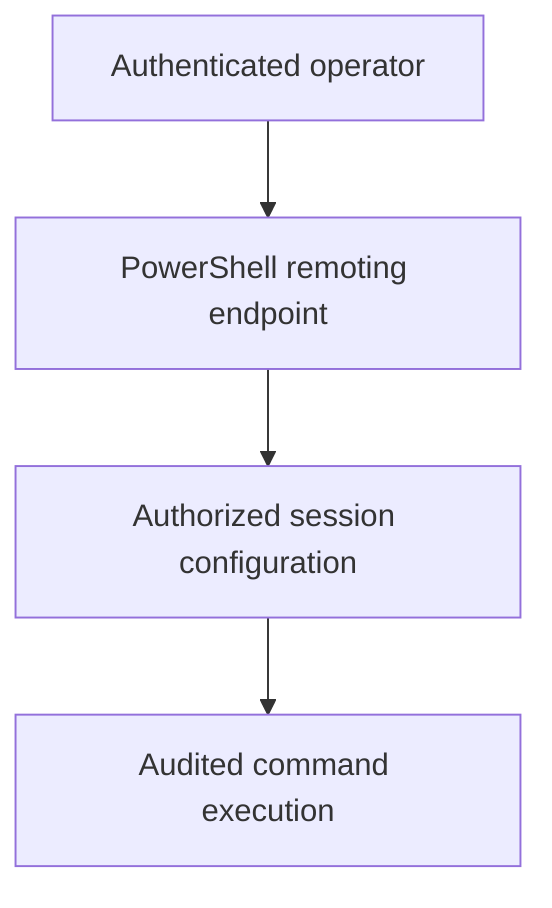

# Windows and PowerShell for Operations

[← Home](../README.md) · [Contents](../TABLE-OF-CONTENTS.md)

PowerShell is useful when Windows hosts, Microsoft services, or a mixed Linux/Windows fleet are in scope. It is not a prerequisite for every Linux-first DevOps role, so learn it when the target job or environment needs it.

## The central idea: objects, not text

A traditional shell pipeline often connects text streams. PowerShell usually passes .NET objects with named properties and methods. Formatting is mainly a final display concern.


```powershell
Get-Service |
    Where-Object Status -eq 'Running' |
    Select-Object Name, Status
```

Because the pipeline carries structured values, filter on `Status` rather than trying to parse aligned console text.

## Minimum command-discovery loop

```powershell
Get-Command -Noun Service
Get-Help Get-Service -Examples
Get-Service | Get-Member
```

- `Get-Command` discovers cmdlets, functions, aliases, and applications.
- `Get-Help` explains syntax and examples; help may need to be updated in an administrative session.
- `Get-Member` reveals the object type, properties, and methods received from a pipeline.
- Cmdlets normally follow the `Verb-Noun` pattern, such as `Get-Service` or `Restart-Service`.

## Core topics in learning order

1. Command discovery and object inspection.
2. Variables, arrays, hash tables, strings, dates, and `$null`.
3. Pipelines: `Where-Object`, `ForEach-Object`, `Select-Object`, grouping, sorting, and measurement.
4. Functions with parameters and predictable output.
5. Errors, exit codes, logging, and idempotency.
6. Files, JSON, CSV, REST APIs, and credentials.
7. Remoting, modules, testing, signing, and execution policy.

## Safe scripting pattern

```powershell
[CmdletBinding(SupportsShouldProcess)]
param(
    [Parameter(Mandatory)]
    [string] $ServiceName
)

$ErrorActionPreference = 'Stop'

try {
    $service = Get-Service -Name $ServiceName

    if ($service.Status -ne 'Running' -and
        $PSCmdlet.ShouldProcess($ServiceName, 'Start service')) {
        Start-Service -Name $ServiceName
    }
}
catch {
    Write-Error "Service operation failed: $($_.Exception.Message)"
    exit 1
}
```

This gives the script a declared input, terminating-error behavior, `-WhatIf` support through `ShouldProcess`, and an explicit failure exit code. For shared automation, return structured objects and keep human-readable formatting at the caller boundary.

## Error model to remember

PowerShell distinguishes terminating and non-terminating errors. A `try`/`catch` block catches terminating errors. Use `-ErrorAction Stop` for an individual command or set `$ErrorActionPreference = 'Stop'` deliberately within a controlled script scope.

Do not confuse these values:

| Value | Meaning |
|---|---|
| `$?` | Whether the most recent operation succeeded |
| `$LASTEXITCODE` | Exit code from the last native executable |
| `$_` | Current pipeline item, or current error inside `catch` |
| `$Error` | Recent error-record collection |

Native programs do not automatically share every PowerShell error behavior. Check their documented exit codes and capture standard output/error when automation depends on them.

## Data and APIs

```powershell
$config = Get-Content -Raw -Path './config.json' | ConvertFrom-Json
$result = Invoke-RestMethod -Method Get -Uri 'https://example.com/api/health'

[pscustomobject]@{
    Name   = $config.name
    Status = $result.status
} | ConvertTo-Json
```

Use `-LiteralPath` for untrusted or unusual file names. Validate parsed data before acting. Never interpolate secrets into command lines, logs, URLs, or source control.

## Remoting and security



- Prefer approved WinRM/PowerShell Remoting or SSH-based remoting over improvised remote-execution tools.
- Use least-privilege accounts and constrained endpoints where appropriate.
- Understand the second-hop problem before accessing another network resource from a remote session.
- Use a managed secret store, workload identity, or platform credential mechanism. Do not create `SecureString` values in source code and assume that makes a literal secret safe.
- Execution policy is a safety feature, not a complete security boundary. Signing, permissions, application control, endpoint protection, and logging still matter.
- Design bulk changes with `-WhatIf`, canaries, timeouts, bounded concurrency, and rollback or compensation steps.

## Role relevance

| Role | Priority | Learn first | Deprioritize initially |
|---|---:|---|---|
| Windows Administrator | Very high | AD-aware administration, services, events, registry, remoting, modules | Advanced cross-platform build tooling |
| DevOps Engineer | Medium when Windows exists | APIs, files, CI scripts, modules, secret handling | Deep desktop administration |
| SRE | Medium when services run on Windows | telemetry, incident scripts, remoting safety, performance counters | GUI-only workflows |
| Platform Engineer | Medium for mixed fleets | reusable modules, policy, images, CI runners, self-service | one-off host fixes |
| Linux Administrator | Low unless fleet is mixed | discovery, structured pipeline, remote diagnostics | deep Windows internals |

## What proves competence

- Write a read-only inventory script that returns structured objects.
- Make a configuration change idempotent and support `-WhatIf`.
- Call an API, validate the response, and fail with a useful exit code.
- Run a command against a small canary group before a larger fleet.
- Package reusable functions as a module and test them with Pester.

Official reference: [Microsoft PowerShell documentation](https://learn.microsoft.com/powershell/).

