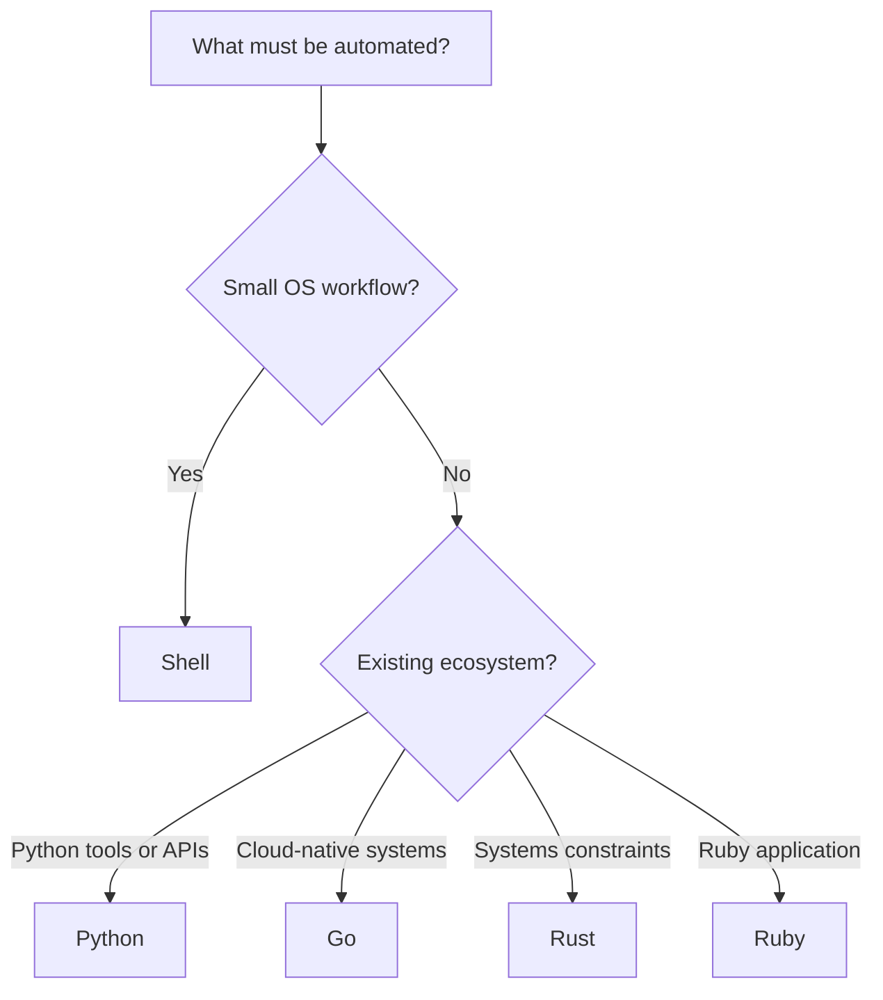

# Programming-Language Direction for Infrastructure Roles

[← Home](../README.md) · [Contents](../TABLE-OF-CONTENTS.md)

The source notes touched shell, Python, Go, Ruby, Groovy, PowerShell, and Rust. You do not need equal depth in all of them. Build one dependable automation path first, then add a language only when it matches a role, codebase, or operational constraint.

## A practical selection flow

Groovy belongs mainly in this archive as Jenkins Pipeline syntax. It is a different language from Ruby. YAML and JSON are data/configuration formats, not general-purpose programming languages.

## Role-based priority

| Skill | DevOps | SRE | Platform | Linux Admin | Best use |
|---|---:|---:|---:|---:|---|
| Shell | Must | Must | Must | Must | Local orchestration and command composition |
| Python | High | High | High | Medium | APIs, automation, data processing, tests |
| Go | Medium | High | High | Low | Cloud-native services, operators, CLIs, concurrency |
| Rust | Optional | Medium | Medium | Optional | Safe systems tools and performance-sensitive agents |
| PowerShell | Environment-dependent | Environment-dependent | Environment-dependent | Mixed-fleet dependent | Windows and Microsoft automation |
| Groovy | Tool-dependent | Low | Tool-dependent | Low | Jenkins Pipeline and JVM ecosystem |
| Ruby | Stack-dependent | Stack-dependent | Stack-dependent | Low | Ruby applications, Chef, or established tools |

“Low” does not mean useless. It means do not spend scarce interview-preparation time on it unless the job description or target environment demands it.

## The common core across languages

Learn these concepts once, then recognise their syntax in each language:

1. Values, types, variables, collections, and control flow.
2. Functions, modules/packages, scope, and interfaces.
3. Files, processes, environment variables, signals, and exit codes.
4. HTTP clients, authentication, JSON/YAML parsing, and input validation.
5. Errors, retries, timeouts, cancellation, and cleanup.
6. Logging, metrics, configuration, and secret handling.
7. Unit tests, integration tests, dependency pinning, formatting, and linting.
8. Concurrency, shared state, resource limits, and graceful shutdown.
9. Packaging, release artifacts, provenance, and vulnerability updates.

## Shell: your first operational layer

Use shell for short, local workflows built from trusted commands. Enable strict behavior intentionally, quote expansions, validate input, and prefer clear multi-step scripts over clever pipelines. Switch to Python, Go, or Rust when data structures, concurrency, complex error handling, or long-term maintenance dominate.

Evidence project: create a read-only Linux diagnostic bundle that records command versions, applies timeouts, redacts obvious secrets, and returns a non-zero exit code when collection fails.

## Python: fastest general automation path

Focus on:

- virtual environments and locked dependencies;
- `pathlib`, `subprocess`, JSON, HTTP clients, and argument parsing;
- exceptions, context managers, typing, logging, and tests;
- request timeouts, retry bounds, pagination, rate limits, and idempotency;
- packaging a small CLI instead of leaving a loose script.

Evidence project: reconcile a desired YAML inventory with a mock REST API. Implement dry-run, diff, retries, structured logs, tests, and a safe failure mode.

## Go: cloud-native and platform depth

Focus on packages, modules, interfaces, error wrapping, `context.Context`, goroutines/channels, HTTP servers and clients, tests, profiling, and cross-compilation. Learn Kubernetes client libraries and controller reconciliation only after the language fundamentals.

Evidence project: build a health-aggregation service with bounded concurrency, deadlines, Prometheus-format metrics, graceful shutdown, and a small container image.

## Rust: a deliberate specialization

Use the dedicated [Rust for operations](../11-rust-automation-ai/01-rust-for-operations.md) chapter. Rust is valuable when memory safety, predictable resource use, single-binary delivery, or low-level integration justifies a steeper learning curve. It is not required for most entry-level DevOps interviews.

## Ruby and Groovy: follow the environment

Learn Ruby when you operate a Ruby application or an organisation uses Ruby-based infrastructure tooling. Learn Groovy to the depth needed to read and safely change Jenkins Pipelines. Do not treat superficial syntax familiarity as production readiness; error behavior, dependency management, testing, and secret handling still matter.

## Avoid these learning traps

- Starting six beginner courses and completing no production-shaped project.
- Memorising syntax without learning I/O, failures, tests, and packaging.
- Writing a custom parser when a maintained structured-data library exists.
- Retrying every error forever or retrying non-idempotent actions blindly.
- Logging tokens, passwords, request bodies, or environment dumps.
- Running shell commands through string concatenation with untrusted input.
- Using a programming language to hide a weak operational design.
- Building Kubernetes operators before understanding reconciliation and the Kubernetes API.

## Retention loop

For each chosen language, build the same small tool four times:

1. Week 1: read local state and print structured output.
2. Week 2: add validation, useful errors, and unit tests.
3. Week 3: call an API with timeout, retry policy, and authentication from a safe source.
4. Week 4: package it, run it in CI, emit telemetry, and document rollback or safe re-run behavior.

One finished tool with tests, a release artifact, and operational documentation is stronger evidence than several disconnected syntax notebooks.

