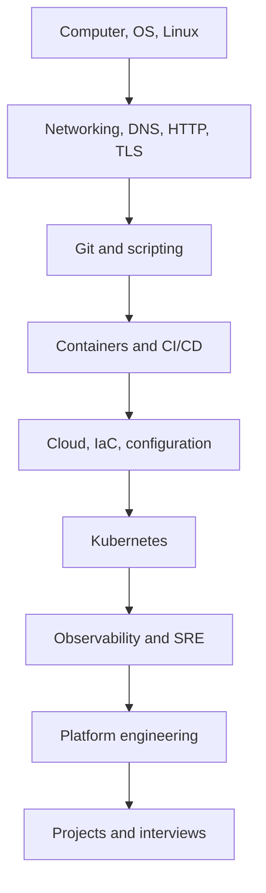

# DevOps Knowledge System — 2026 Edition

> A curated, corrected, and directional version of Maninderjit Singh's handmade notes.
>
> Research snapshot: **7 August 2026**. Commands use safe examples such as `example.com` and documentation-only IP ranges.

## What this archive is

This is not a command dump. It is a connected mental model for learning how a request moves from a user to an application, how that application is built and deployed, and how an engineer keeps it secure and reliable.

## Start here

1. [Knowledge map](00-start-here/01-knowledge-map.md) — the order and dependencies.
2. [Study and retention system](00-start-here/02-study-and-retention.md) — how to make the knowledge stay.
3. [Source audit and corrections](00-start-here/03-source-audit-and-corrections.md) — what your notes already covered, what was missing, and what was corrected.
4. [Core glossary](00-start-here/04-core-glossary.md) — compact definitions you should be able to explain aloud.
5. [Interview tracks](interview/README.md) — DevOps, SRE, Platform Engineering, and Linux Administration.
6. [Complete table of contents](TABLE-OF-CONTENTS.md) — direct link to every chapter.
7. [Hands-on lab path](00-start-here/05-hands-on-lab-path.md) — learn by building, breaking, and recovering.

## Library map

| Folder | Purpose | Read when |
|---|---|---|
| `01-foundations` | OS, kernel, networking, Git, scripting | Always first |
| `02-linux-administration` | Users, services, storage, security, troubleshooting | Before Docker/Kubernetes |
| `03-containers` | Container internals, Docker, Compose, security | After Linux |
| `04-kubernetes` | API, workloads, networking, storage, operations | After containers and networking |
| `05-iac-configuration` | OpenTofu/Terraform, Ansible, testing | Before production automation |
| `06-ci-cd` | Delivery flow, Jenkins, GitHub Actions, supply chain | After Git and containers |
| `07-cloud` | AWS-first cloud mental models with cross-cloud mapping | After networking and IaC |
| `08-observability-sre` | OTel, SLOs, incidents, capacity | After deploying a service |
| `09-platform-engineering` | Platforms as products, GitOps, golden paths | After Kubernetes and delivery |
| `10-data-systems` | DBMS, SQL, data pipelines, data-platform lessons | Role/project dependent |
| `11-rust-automation-ai` | Rust for operations and guarded AI agents | Optional specialization |
| `12-projects` | Portfolio architectures and evidence templates | During interview preparation |
| `13-optional-source-notes` | Finance, PowerShell, and language notes kept outside the core path | Read only when personally or role relevant |
| `interview` | Role-specific must-study and deprioritize lists | Before applications |
| `appendix` | Commands, source coverage, references | Lookup, not linear study |

## One rule for every topic

For every technology, answer these seven questions:

1. What problem does it solve?
2. Where does it run?
3. What inputs and outputs does it have?
4. What state does it own?
5. Which network ports and protocols does it use?
6. How does it fail, and what evidence proves the failure?
7. How is it secured, upgraded, backed up, and recovered?

If you can answer those seven questions without memorized wording, you understand the topic.

## Version-sensitive facts

As of this research snapshot, Kubernetes `1.36.2` and OpenTofu `1.12.5` were current upstream releases. Never memorize a current version as a permanent fact. Check the official release pages before installing or answering a version-specific question.

## Safety note

The supplied export contained a credentials CSV and credential-like examples. Secrets, personal interview contacts, literal infrastructure addresses, and duplicated exports were not copied into this archive. The useful concepts and incident lessons were retained in sanitized form. Non-core finance and language material is preserved in `13-optional-source-notes` so it does not distract from the role-directed path.
