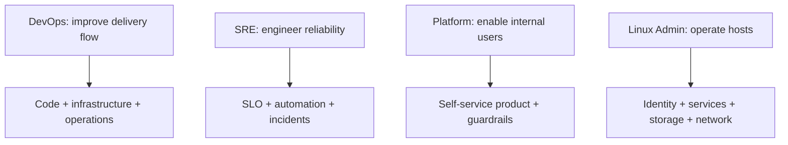

# Role Comparison and Study Weights

[← Interview index](README.md)

| Domain | DevOps | SRE | Platform | Linux Admin |
|---|---:|---:|---:|---:|
| Linux internals/admin | High | High | Medium–High | Critical |
| Networking/DNS/TLS | High | High | High | Critical |
| Git and scripting/programming | Critical | Critical | Critical | High |
| CI/CD | Critical | High | Critical | Low–Medium |
| Containers | Critical | High | High | Medium |
| Kubernetes | High | High for K8s roles | Critical | Low–Medium |
| IaC/config management | Critical | High | Critical | High (Ansible) |
| Cloud | High | High | High | Role dependent |
| Observability | High | Critical | High | High |
| SLO/error budget/on-call | Medium | Critical | Medium–High | Low–Medium |
| Platform product/DX/GitOps | Low–Medium | Medium | Critical | Low |
| Storage/backup/recovery | High | High | High | Critical |
| Data platform tools | Project dependent | Project dependent | Platform dependent | Usually low |
| Rust/AI agent | Optional differentiation | Optional | Optional | Usually low |

## Role intent

Titles overlap. Responsibilities in the job description matter more than the label.

## Topics from your source notes that are not universal must-haves

| Topic | When it matters | When to deprioritize |
|---|---|---|
| Trino/Hive/Querybook/Ranger/Airflow/Spark | data-platform role or project discussion | generic DevOps/Linux interview |
| Ruby/Rails | company stack explicitly uses it | infrastructure role without application ownership |
| deep PowerShell | Windows/hybrid environment | Linux-first role |
| Go/Rust internals | programming-heavy automation/platform/SRE | when role asks only basic scripting |
| advanced Nmap/Wireshark | network/security/packet troubleshooting | generic delivery interview; keep basic use |
| AI/LLM/Cognee | AI platform or your differentiating project | core infrastructure screening |
| deep Kubernetes API/operators | platform/Kubernetes/SRE role | junior Linux admin or ECS-only DevOps role |
| static-site cost calculations | FinOps/cloud design example | general technical screen unless cost asked |
| finance investment notes | personal domain | all four technical role tracks |

## Depth over breadth

For the chosen role, prepare 8–12 must topics at “explain + operate + troubleshoot” depth. Keep optional topics at “explain why/when” depth. Avoid presenting 40 tools without one end-to-end system.

