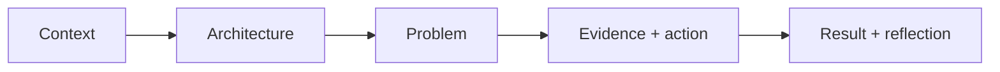

# Project and Behavioral Storytelling

[← Interview index](README.md)

## Technical story structure

Use CAPER:

- Context: system, users, constraints, your ownership.
- Architecture: request/data flow and state.
- Problem: impact and exact symptom.
- Evidence/action: hypotheses, proof, decisions, mitigation.
- Result/reflection: verification, measurable outcome, prevention, next improvement.

## Separate your contribution

Say “the team” for shared outcome and “I” for your verified actions. State whether this was production, internship, personal lab, hackathon, or design exercise. Honest scope builds trust.

## Prepare six stories

1. Hard incident/troubleshooting.
2. Automation that reduced manual work.
3. Security/reliability improvement.
4. Disagreement/trade-off and collaboration.
5. Failure/mistake and what changed.
6. Learning a new system under constraint.

Each should be 90–150 seconds with an optional deep-dive branch.

## Strong evidence

- before/after lead time or steps;
- alert/detection/recovery time;
- test coverage or failure caught;
- resource/cost change with assumptions;
- restore/game-day result;
- deployment frequency/failure change;
- security permission/exposure reduction;
- concrete logs/metrics/events that proved cause.

Do not invent numbers. “Reduced a 12-step manual deployment to one reviewed pipeline with three validation gates” is measurable even without financial data.

## Your likely best stories

- NFS/Postgres numeric UID permission root cause.
- SigNoz/OpenTelemetry health validation and understanding telemetry pipeline.
- GCP/OpenTofu deployment phases and quota/provider/image differences.
- Container conflict/port/model/runtime failure and safe diagnosis.
- One-command Rust/infra automation with idempotent phase checkpoints.

## Questions to ask interviewer

- What user journeys/services does this role own?
- How are reliability objectives and on-call handled?
- What is the change/review/deployment model?
- Which work is currently the largest operational toil?
- How do platform/application/security teams divide ownership?
- What would success in the first 90 days look like?

