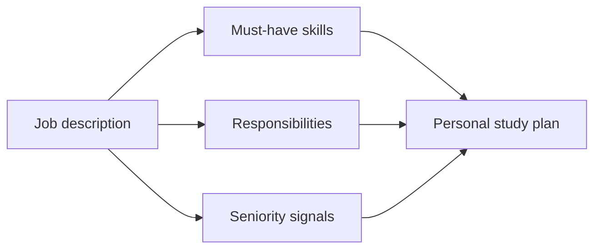

# Interview Paths

[← Home](../README.md)

Your notes span more than one job. Do not study every folder equally for every application. Start with the job description, then use the matching path:

- [Role comparison](01-role-comparison.md)
- [DevOps Engineer](02-devops-engineer.md)
- [Site Reliability Engineer](03-sre.md)
- [Platform Engineer](04-platform-engineer.md)
- [Linux Administrator](05-linux-administrator.md)
- [Project storytelling](06-project-storytelling.md)
- [Scenario question bank](07-scenario-question-bank.md)
- [12-week preparation plan](08-twelve-week-plan.md)

## Universal interview core

Every target role should be able to:

1. explain a web request from DNS to application;
2. troubleshoot a failed Linux service from evidence;
3. use Git safely and describe a delivery pipeline;
4. explain identity, least privilege, secrets, backups, and monitoring;
5. tell one real incident with root cause and prevention;
6. draw one project architecture and defend trade-offs;
7. say “I don't know, here is how I would verify” clearly.

## Use the job description as weights

Mark each requirement:

- green: can explain + operate + give evidence;
- yellow: understand but limited hands-on;
- red: cannot yet explain;
- irrelevant: not in this role.

Prioritize red must-haves, then strengthen yellow project proof. Do not spend the week before a Linux admin interview deep-diving Trino, AI agents, or advanced Kubernetes operators unless the description requires them.

## Honest calibration

At an early-career level, employers value a sound troubleshooting method, correct fundamentals, safe judgment, and proof of learning more than claiming mastery of every tool. State what you operated personally, what you built in a lab, and what you only studied.

